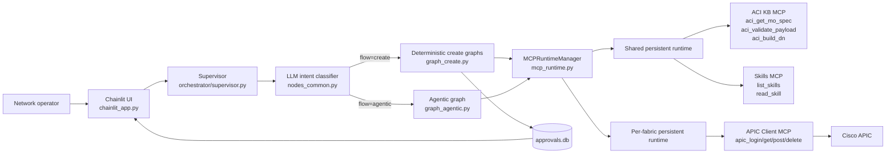
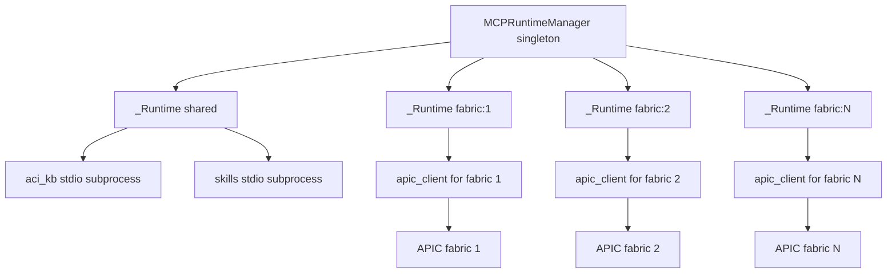
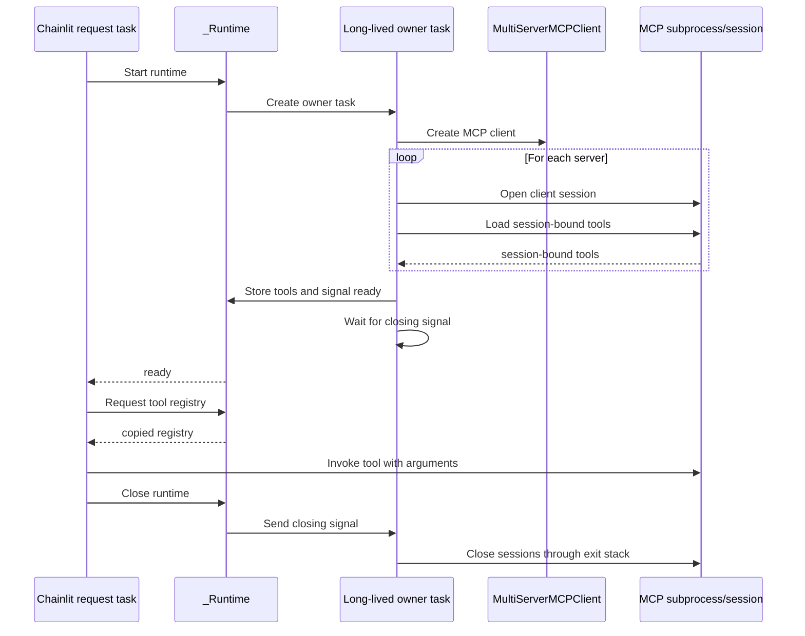
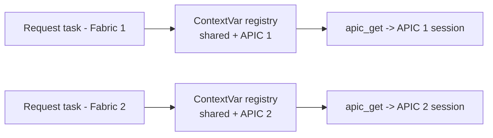

# ACI LangGraph Orchestrator - Mimari Dokumani

Bu dokuman projenin calisan mimarisini, ana bilesenlerini, veri akisini ve kalici
async MCP runtime tasarimini aciklar. Kullanici olusturma, parola uretme ve kimlik
bilgisi yonetimi (`users.py`, `make_password.py`) kapsam disindadir.

Prompt bazinda calisan fonksiyonlarin tam sirasi ve her create/agentic alt akisinin
ayrintisi [REQUEST-FLOW.md](REQUEST-FLOW.md) icindedir.

## 1. Projenin Amaci

Uygulama, dogal dilde gelen Cisco ACI taleplerini iki farkli yoldan isler:

1. **Deterministik create akisi:** Tenant/BD olusturma, EPG bind etme, VMM domain
   EPG'lerini bind etme, port tanimlama ve mevcut tanimlari kopyalama gibi yazma
   islemlerini kontrollu bir plana cevirir. Plan onaylanmadan APIC'e POST yapilmaz.
2. **Agentic read/troubleshooting akisi:** Listeleme, arama, sayma, obje inceleme,
   saglik ve ariza analizi gibi diger butun istekleri read-only ReAct dongusuyle
   cozer. Agent gerekli skill dokumanlarini ve ACI class bilgisini kullanarak APIC
   GET sorgularini kendisi secer.

Chainlit web arayuzu oturum, fabric secimi, mesaj gosterimi ve onay ekranini
yonetir. LangGraph is akislarini yurutur. MCP server'lar ise ACI semasi, APIC HTTP
erisimi ve operasyonel skill dokumanlarini araclar olarak sunar.

## 2. Ust Seviye Bilesen Mimarisi

### Katmanlar

| Katman | Ana dosyalar | Sorumluluk |
|---|---|---|
| Sunum ve oturum | `chainlit_app.py` | Fabric profili, mesaj kabul etme, sonucu gosterme, admin onayi |
| Orkestrasyon | `orchestrator/supervisor.py` | Tool yukleme, intent'e gore create/agentic yonlendirme, ozel create hazirlayicilari |
| Workflow | `graph_create.py`, `graph_agentic.py` | LangGraph node sirasi, dongu ve bitis kosullari |
| Node/alan mantigi | `nodes_common.py`, `nodes_create.py`, `nodes_port.py`, `nodes_agentic.py` | LLM cagrilari, payload/DN, port/EPG cozme, ReAct dongusu |
| Bilgi tabani | `agentic_aci_kb.py`, `aci_kb/` | ACI class arama, schema ve DN bilgisi |
| MCP runtime | `orchestrator/mcp_runtime.py` | MCP subprocess/session yasam dongusu ve fabric izolasyonu |
| MCP server'lar | `../MCP_Servers/*/server.py` | FastMCP ile tool yayinlama |
| APIC istemcisi | `../MCP_Servers/APIC_CLIENT_MCP/apic_client/` | HTTP session, login/token yenileme, hata donusumu |
| Onay kaliciligi | `approvals.py` | SQLite tabanli bekleyen/onaylanan/reddedilen istekler |
| Gozlemlenebilirlik | `chainlit_app.py`, Phoenix/OpenInference | LangChain/LLM trace'lerini Phoenix collector'a gonderme |

## 3. Calisan Akislar ve Eski Moduller

Aktif giris noktasi `chainlit_app.py -> supervisor.prepare()` akisidir.
`supervisor.py` yalnizca `graph_create.py` ve `graph_agentic.py` graph'larini
cagirir.

## 4. Uygulama Baslangici ve Oturum

### 4.1 Modul yuklenirken

`chainlit_app.py` import edildiginde su islemler gerceklesir:

1. `load_dotenv()` ortam degiskenlerini yukler.
2. Phoenix `register(...)` ile tracer provider olusturulur.
3. `LangChainInstrumentor().instrument(...)` LangChain cagrilarini izlemeye alir.
4. Chainlit callback'leri kaydedilir.
5. `get_runtime_manager()` henuz server baslatmaz. Singleton manager ilk
   kullanildiginda olusturulur; MCP runtime'lar lazy olarak acilir.

### 4.2 Fabric secimi

`_FABRIC_IDS = (1, 2, 3, 4)` en fazla dort fabric profilini destekler.

- `_fabric_config(fid)`: `FABRIC_<n>_*` degiskenlerinden bir fabric sozlugu kurar.
- `_all_fabrics()`: Tanimi bulunan fabric'leri listeler. Hic yeni formatli tanim
  yoksa legacy `APIC_CLIENT_PYTHON` ve `APIC_CLIENT_SERVER` ile tek default fabric
  olusturur.
- `chat_profiles()`: Her fabric'i Chainlit `ChatProfile` olarak yayinlar.
- `_fabric_by_name(name)`: Kalici onay kaydindaki veya resume edilen profildeki
  isimden fabric konfigurasyonunu bulur.
- `_setup_session()`: Secilen fabric'i, kullanici rolunu ve team bilgisini
  `cl.user_session` icine yazar.

### 4.3 Chat baslatma ve resume

`on_chat_start()`:

1. Approval SQLite semasini `approvals.init()` ile hazirlar.
2. `_setup_session()` ile fabric/role/team degerlerini oturuma yerlestirir.
3. `get_runtime_manager().warm(fabric)` cagirir.
4. Warm-up basarisiz olsa bile chat acilir; hata loglanir ve ilk gercek istekte
   kullaniciya yansir.
5. Kullaniciya desteklenen akislarin ozetini gosterir.

`on_chat_resume(thread)` thread metadata'sindaki `chat_profile` degerini geri
yukler, session'i tekrar kurar ve ilgili fabric runtime'ini warm eder. Resume
hatasinda default fabric'e geri doner.

## 5. Kalici Async MCP Runtime

### 5.1 Neden gerekli?

Eski `MultiServerMCPClient.get_tools()` kullanimi session'a bagli olmayan tool
nesneleri uretiyordu. Her `ainvoke()` asagidaki maliyetleri tekrar olusturabiliyordu:

- yeni stdio Python subprocess,
- Python import zinciri,
- APIC istemcisi olusturma,
- TLS baglantisi,
- `aaaLogin`,
- MCP initialize ve tools/list.

Yeni tasarimda `client.session(server_name)` ile acilan session kapanmadan tutulur
ve `load_mcp_tools(session)` ile **o acik session'a bagli tool nesneleri** yuklenir.
Boylece subprocess ve APIC `requests.Session` uygulama boyunca tekrar kullanilir.

### 5.2 Runtime topolojisi

`aci_kb` ve `skills` fabric'ten bagimsiz oldugu icin tek shared runtime'da
calisir. Her fabric'in farkli server deployment'i ve `.env` APIC credential'i
oldugu icin `apic_client` runtime'i fabric basina ayridir.

### 5.3 Baglanti konfigurasyonu

- `_shared_connections()` iki stdio baglantisi dondurur:
  - `ACI_KB_PYTHON` + `ACI_KB_SERVER`
  - `SKILLS_PYTHON` + `SKILLS_SERVER`
- `_fabric_connection(fabric)` secilen fabric'in
  `apic_client_python` + `apic_client_server` degerlerinden tek baglanti kurar.
- `_fabric_key(fabric)` runtime cache anahtari olarak once `id`, yoksa `name`
  kullanir.

Her baglanti `{"command": ..., "args": [...], "transport": "stdio"}`
seklindedir. `command` server'i calistiracak Python executable, `args[0]` ise
server script yoludur.

### 5.4 `_Runtime` yasam dongusu

Temel alanlar:

- `_tools`: Session-bound tool adindan tool nesnesine map.
- `_owner_task`: Session'lari acan ve kapatan uzun omurlu asyncio task'i.
- `_ready`: Butun session ve tool'lar hazir oldugunda set edilir.
- `_closing`: Kapanis talebini owner task'a iletir.
- `_error`: Startup sirasindaki hatayi bekleyen cagiriciya aktarir.

Temel metotlar:

- `_owner()`: Client'i kurar, `AsyncExitStack` icinde her session'i acar,
  `load_mcp_tools(session)` ile tool'lari toplar ve kapanis sinyalini bekler.
  Ayni runtime icindeki duplicate tool adinda ilk tool'u tutar ve warning yazar.
- `start(timeout)`: Owner task'i olusturur ve `_ready` event'ini
  `MCP_START_TIMEOUT` kadar bekler. Timeout veya startup hatasinda task'i iptal
  eder ve acik bir `RuntimeError` uretir.
- `healthy()`: Owner task calisiyor, startup hatasi yok ve tool registry bos
  degilse `True` dondurur.
- `tools()`: Ic registry'nin kopyasini dondurur; cagirici dogrudan runtime
  state'ini degistiremez.
- `_cancel()`: Owner task'i cancel eder ve shutdown istisnalarini yutar.
- `close()`: `_closing` event'ini set eder; session context'lerinin owner task
  icinde kapanmasini bekler.

### 5.5 Owner-task deseninin nedeni

MCP stdio transport anyio task group/cancel scope kullanir. Bir cancel scope,
hangi task icinde acildiysa o task icinde kapatilmalidir. Chainlit'in
`on_chat_start`, `on_message` ve kapanis callback'leri farkli asyncio task'larinda
calisabildigi icin session'i bir callback'te acip digerinde kapatmak
`Attempted to exit cancel scope in a different task` hatasi uretebilir.

Bu nedenle session'in `__aenter__` ve `__aexit__` islemleri `_owner()` adli tek
task icinde gerceklesir. Request task'lari sadece tool cagirir veya event ile
kapanis sinyali verir.

### 5.6 `MCPRuntimeManager`

- `_get_shared()`: Shared runtime saglikliysa cache'den dondurur. Degilse
  `_shared_lock` altinda kapatip yeniden kurar.
- `_get_fabric(fabric)`: Fabric key ile cache'e bakar. Fabric basina
  `asyncio.Lock` kullanarak ayni anda gelen iki ilk istegin iki ayri subprocess
  acmasini engeller. Sagliksiz runtime'i recycle eder.
- `get_registry(fabric)`: Once fabric runtime'ini, sonra shared runtime'i alir.
  Her request icin yeni bir sozlukte shared tool'lari ve sadece secili fabric'in
  APIC tool'larini birlestirir. Isim cakismasinda fabric tool'u kazanir.
- `warm(fabric)`: `get_registry()` cagirarak subprocess/session'lari onceden
  acar. Best-effort'tur; exception'i loglar, disari firlatmaz.
- `aclose()`: Cache'deki tum fabric runtime'larini ve shared runtime'i kapatir.
- `get_runtime_manager()`: Modul seviyesinde tek `MCPRuntimeManager` olusturan
  lazy singleton accessor'dur.

Not: `aclose()` mevcut olsa da `chainlit_app.py` icinde su anda onu cagiran bir
app-shutdown callback'i yoktur. Parent process sonlandiginda child process'ler de
sonlanir; kontrollu shutdown isteniyorsa uygun Chainlit lifecycle hook'una
`await get_runtime_manager().aclose()` baglanmalidir.

### 5.7 Tool registry'nin request'e yuklenmesi

`supervisor._load_tools(fabric)` sirayla sunlari yapar:

1. `get_runtime_manager().get_registry(fabric)` ile shared + secili fabric
   tool'larini alir.
2. MCP disinda, ayni process'te calisan `aci_lookup_class` LangChain tool'unu
   registry'ye ekler.
3. `nodes_common.set_tools(registry)` ile registry'yi task-local `ContextVar`'a
   yazar.

`nodes_common.py` icindeki API:

- `set_tools(d)`: Registry'nin kopyasini mevcut async context'e yazar.
- `get_tool(name)`: Isme gore tool'u alir; yoksa mevcut tool adlariyla hata verir.
- `get_all_tools()`: Registry'nin kopyasini dondurur.

Normal module-global dict kullanilmaz. Aksi halde Fabric 1 ve Fabric 2 istekleri
es zamanli calisirken son yazan request digerinin APIC tool'unu ezebilirdi.
`ContextVar`, Chainlit request task'i ve ondan dogan LangGraph async cagrilari
boyunca dogru registry'yi tasir.

## 6. MCP Server'lar

### 6.1 ACI KB MCP

Dosya: `../MCP_Servers/ACI_KB/server.py`

Network cagrisi yapmaz. `aci.db`/ACI knowledge base uzerinden uc senkron FastMCP
tool'u yayinlar:

- `aci_get_mo_spec(class_name, include_optional=True)`: Class schema, naming ve
  mandatory property'ler, enum degerleri, DN/RN formatlari ve API path'lerini
  dondurur.
- `aci_validate_payload(class_name, payload, is_update=False)`: Eksik/yanlis
  property, enum, regex/range ve read-only/create-only ihlallerini denetler.
- `aci_build_dn(class_name, naming_values, parent_dn=None)`: Naming property ve
  parent DN kullanarak dogru APIC DN/RN olusturur.

### 6.2 Skills MCP

Dosya: `../MCP_Servers/skills_server/server.py`

`skills/*.md` dosyalarini runtime'da okur:

- `list_skills()`: Dosya adi, H1 title ve ilk anlamli satirdan summary listesi
  dondurur.
- `read_skill(skill_name)`: Path traversal guard sonrasinda skill'in tam Markdown
  icerigini dondurur.

Icerik her tool cagrisinda diskten okundugu icin bir skill Markdown dosyasinin
icerigi degistiginde server restart gerekmez. Yeni/degisen dosya sonraki
`list_skills`/`read_skill` cagrisinda gorulur.

### 6.3 APIC Client MCP

Dosya: `../MCP_Servers/APIC_CLIENT_MCP/server.py`

- `apic_login()`: Zorunlu yeniden login (`force=True`).
- `apic_get(path, params=None)`: Class veya MO GET sorgusu.
- `apic_post(path, payload)`: Create/update POST.
- `apic_delete(path)`: MO DELETE.

FastMCP wrapper, `APICError` exception'larini LLM'in okuyabilecegi structured
dict'e cevirir. Gercek HTTP isi `apic_client/client.py` icindeki singleton
`APICClient` tarafindan yapilir.

APIC istemcisi:

- process basina tek instance (`get_client()`),
- tek kalici `requests.Session` ve cookie jar,
- ilk gercek request'te lazy login,
- `refreshTimeoutSeconds` tabanli token TTL,
- `APIC_REFRESH_BEFORE` kadar erken yenileme,
- login sirasinda `threading.Lock`,
- yetki kaybinda yeniden authentication,
- SSL verification ve timeout icin environment ayarlari

kullanir. MCP subprocess kalici oldugu icin bu singleton ve HTTP keep-alive da
artik request'ler arasinda gercekten kalicidir.

## 7. LLM Katmani

`nodes_common.get_llm()` process icinde tek `ChatOpenAI` nesnesi olusturur:

- `LITELLM_BASE_URL`: OpenAI-compatible LiteLLM endpoint,
- `LITELLM_API_KEY`: API anahtari,
- `LITELLM_MODEL`: model adi,
- `temperature=0`: intent/payload/action uretiminde daha deterministik davranis.

LLM uc ana yerde kullanilir:

1. `recognize_intent()`: Prompt'u create veya agentic olarak siniflandirir ve
   create parametrelerini JSON olarak cikarir.
2. `build_payload()` / `fix_payload()`: Genel tenant/BD schema'sindan APIC
   attribute payload'i olusturur veya validator hatalarina gore duzeltir.
3. `make_plan()` / `think_and_act()`: Agentic inceleme planini ve her ReAct
   aksiyonunu uretir.

`extract_json_from_llm()` code fence, metin icindeki dengeli JSON, eksik acilis
brace'i ve eksik kapanis brace'leri icin kontrollu onarim uygular. Intent parse
edilemezse guvenli varsayilan olarak agentic akisa gecilir.

## 8. LangGraph State Modeli

`orchestrator/state.py` icindeki `GraphState` ortak TypedDict'tir.

| Alan | Amac |
|---|---|
| `user_input` | Ham kullanici prompt'u |
| `intent`, `params`, `target_class`, `flow` | Intent classifier ciktisi |
| `schema`, `payload`, `dn`, `parent_dn` | Genel create hazirlik verisi |
| `validation_result`, `validation_attempts` | Schema validation dongusu |
| `post_path`, `post_body` | Ozel atomik POST builder'larinin ciktisi |
| `chat_history` | Ayni Chainlit thread'indeki son 10 tamamlanmis user/assistant turn'u |
| `agent_messages` | Agent LLM context'i; reducer ile listeye eklenir |
| `agent_iterations` | ReAct adim sayaci |
| `agent_final_answer` | Agentin son kullanici cevabi |
| `agent_malformed_retries` | Bozuk JSON aksiyon retry sayisi |
| `agent_observations` | Tool sonucundan kisa fallback kanitlari |
| `selected_skills` | Bu turn'de keyword-heuristigin isaret ettigi (advisory, henuz yuklenmemis) skill'ler |
| `final_result`, `interpretation` | APIC cevabi ve LLM sonucu aciklamasi |
| `errors`, `trail` | Birikimli hata ve kullaniciya gosterilebilir adim kaydi |

`errors`, `trail` ve `agent_messages`, LangGraph `Annotated[list, add]` reducer'i
ile node ciktisi geldikce birikir. Diger alanlar son yazilan degeri tutar.

`chat_history`, Chainlit'in mevcut `chat_history.db` thread kayitlarindan resume
sirasinda yeniden kurulur ve hem intent classifier'a hem `prepare_agent()`
context'ine verilir. Yalnizca son 10 tamamlanmis user/assistant turn'u tutulur;
approval komutlari, tool step'leri ve eksik turn'ler dahil edilmez.
`agent_messages` ise yalnizca mevcut graph invocation'inin plan/tool scratchpad'i
oldugu icin turn'ler arasinda saklanmaz. Bu nedenle conversation memory icin
LangGraph checkpointer kullanilmaz.

## 9. Onay ve Yazma Guvenligi

Yazma islemleri iki katmanda korunur:

1. `nodes_agentic.WRITE_TOOLS = {"apic_post", "apic_delete"}`; agentic dongu bu
   tool'lari calistirmayi reddeder.
2. Deterministik create plani Chainlit tarafinda onaya sunulur.

Standart kullanici icin `_curate_plan()` yalnizca execute asamasinda gereken
JSON-serializable alanlari tutar ve `approvals.create()` ile `approvals.db` icine
`pending` olarak kaydeder. Canli bir async task gunlerce beklemez. Admin daha
sonra `approve_request` action'i ile kaydi yukler, kaydin fabric adini yeniden
cozer ve `execute_create(plan, fabric)` cagirir.

Admin'in kendi create istegi `handle_admin_approval()` ile inline
`AskActionMessage` uzerinden onaylanir. Red veya timeout durumunda APIC cagrisi
yapilmaz.

## 10. Konfigurasyon Ozeti

### LLM ve tracing

| Degisken | Anlam |
|---|---|
| `LITELLM_BASE_URL` | OpenAI-compatible LLM endpoint |
| `LITELLM_API_KEY` | LLM API anahtari |
| `LITELLM_MODEL` | Kullanilan model |
| `PHOENIX_PROJECT_NAME` | Trace proje adi |
| `PHOENIX_COLLECTOR_ENDPOINT` | Phoenix OTEL collector |

### Shared MCP

| Degisken | Anlam |
|---|---|
| `ACI_KB_PYTHON` | ACI KB server'i calistiran Python |
| `ACI_KB_SERVER` | ACI KB `server.py` yolu |
| `SKILLS_PYTHON` | Skills server'i calistiran Python |
| `SKILLS_SERVER` | Skills `server.py` yolu |
| `MCP_START_TIMEOUT` | Runtime startup timeout, varsayilan 60 saniye |

### Fabric MCP

Her `n=1..4` icin:

| Degisken | Anlam |
|---|---|
| `FABRIC_n_NAME` | Chat profil/fabric adi |
| `FABRIC_n_DESCRIPTION` | Profil aciklamasi |
| `FABRIC_n_ICON` | Opsiyonel profil ikonu |
| `FABRIC_n_APIC_CLIENT_PYTHON` | O fabric'in MCP Python executable'i |
| `FABRIC_n_APIC_CLIENT_SERVER` | O fabric'in APIC client server script'i |

Legacy tek fabric kurulumu icin `APIC_CLIENT_PYTHON`, `APIC_CLIENT_SERVER` ve
`DEFAULT_FABRIC_NAME` kullanilir. APIC server process'inin kendi environment'i
`APIC_HOST`, `APIC_USERNAME`, `APIC_PASSWORD`, `APIC_VERIFY_SSL`, `APIC_TIMEOUT`
ve `APIC_REFRESH_BEFORE` degerlerini saglamalidir.

### Port definition

- `PORT_DEF_NAMING=prod|test`: Interface profile/selector isim semasi.
- `PORT_DEF_POLICIES=standard|empty`: Standart policy referanslari veya APIC
  default'lari.
- `PORTDEF_CDP`, `PORTDEF_LLDP`, `PORTDEF_LINK_LEVEL`, `PORTDEF_STORM`,
  `PORTDEF_STP`, `PORTDEF_LACP`: Policy bazinda override.

## 11. Modul ve Fonksiyon Sorumluluk Haritasi

### `chainlit_app.py`

| Fonksiyon/sinif | Gorev |
|---|---|
| `RootMessageDataLayer` | User/assistant mesajlarini root step olarak saklar |
| `get_data_layer()` | Chainlit history icin async SQLite data layer verir |
| `_fabric_config()`, `_all_fabrics()`, `_fabric_by_name()` | Fabric konfigurasyonunu kurar ve cozer |
| `chat_profiles()` | Fabric'leri secilebilir Chainlit profillerine cevirir |
| `_setup_session()` | Fabric, role ve team'i session'a yazar |
| `on_chat_start()`, `on_chat_resume()` | Approval DB, chat memory restore ve MCP warm-up dahil lifecycle |
| `on_message()` | Komutlari ayirir, `prepare()` cagirir, flow sonucunu render eder |
| `_plan_text()`, `_curate_plan()` | Create planini gosterir ve kalici kayda uygun hale getirir |
| `_apic_outcome()` | APIC response icindeki hata formatlarini normalize eder |
| `handle_admin_approval()` | Admin'in kendi isteginde inline onay ve execution |
| `show_pending_queue()`, `show_my_requests()` | Approval listeleme ekranlari |
| `on_approve_request()`, `on_deny_request()` | Kalici request karar callback'leri |
| `render_create_result()` | APIC write sonucunu ve trail'i kullaniciya gosterir |

### `orchestrator/chat_memory.py`

| Fonksiyon | Gorev |
|---|---|
| `normalize_chat_history()` | Tamamlanmis turn'leri normalize eder ve son 10'a sinirlar |
| `append_chat_turn()` | Bir user/assistant exchange ekleyip buffer limitini uygular |
| `history_to_messages()` | Turn'leri sirali HumanMessage/AIMessage listesine cevirir |
| `reconstruct_chat_history()` | Chainlit root step'lerinden resume buffer'ini yeniden kurar |

### `supervisor.py`

| Fonksiyon | Gorev |
|---|---|
| `_load_tools()` | Kalici registry'yi ContextVar'a publish eder |
| `_new_state()` | Temiz ortak GraphState baslangici olusturur |
| `_resolve_node_list()` | Switch adlarini numeric node ID'lerine cevirir |
| `_resolve_port_bindings()` | Serial/profile referansini bir veya cok tDn'e acar |
| `_build_binding()` | EPG, encap ve portlari cozup static binding POST plani kurar |
| `_build_vmm_binding()` | VMM domain'in tum EPG'lerini bulup binding plani kurar |
| `_build_port()` | Access/PC/vPC port definition planini kurar |
| `_build_copy_port()` | Kaynak port policy zincirini yeni porta klonlama plani kurar |
| `_build_copy_bindings()` | Kaynak port EPG binding'lerini hedefe kopyalama plani kurar |
| `run()` | Onaysiz/CLI tam akisi; create ise hazirlar ve execute eder |
| `prepare()` | Chainlit icin create'i POST oncesinde durdurur; agentic'i tamamlar |
| `_summarize_create_result()` | APIC write sonucunu kisa metne cevirir |
| `execute_create()` | Onayli planda tool yukler, login+POST graph'ini calistirir |

### Graph ve node modulleri

- `graph_create.py`: Uc graph builder ve validation router.
- `graph_agentic.py`: Agentic node sirasi ve loop router.
- `nodes_common.py`: LLM singleton, ContextVar tool registry, MCP result/LLM JSON
  normalizasyonu, intent classification, APIC login ve switch-name yardimcilari.
- `nodes_create.py`: Schema/payload/validation/DN/POST node'lari; EPG/VMM encap
  cozme ve static binding tree builder'lari.
- `nodes_port.py`: Port referansi/switch profile cozme, kaynak policy okuma ve
  atomik access/PC/vPC APIC tree builder'i.
- `nodes_agentic.py`: Skill routing, plan olusturma, read-only ReAct dongusu,
  dedup/fail-fast/JSON repair ve sonuc formatlama.
- `agentic_aci_kb.py`: BM25 class hint injection ve in-process
  `aci_lookup_class` fallback tool'u.

Bu fonksiyonlarin calisma sirasi, girdileri, ciktilari ve dallanma kosullari
[REQUEST-FLOW.md](REQUEST-FLOW.md) icinde ayrintili olarak verilmistir.

## 12. Bilinen Operasyonel Sinirlar

- `_Runtime.healthy()` owner task'in yasadigini kontrol eder; owner beklemedeyken
  alttaki subprocess sessizce olurse bunu bir sonraki tool cagrisi ortaya cikarir.
  Periyodik MCP ping yoktur.
- `MCP_START_TIMEOUT` startup'i sinirlar, tek bir uzun APIC tool cagrisini
  sinirlayan ortak bir runtime timeout degildir.
- Port tDn builder'larinda `pod-1` sabittir; multi-pod fabric icin genisletme
  gerekir.
- Runtime manager singleton'i process-local'dir. Birden cok application worker
  varsa her worker kendi MCP subprocess setini acar.
- Approval ve Chainlit history SQLite yollari `/root/langgraph-orchestrator/`
  altina sabitlenmistir; Windows/local calistirmada environment'a uygun hale
  getirilmelidir.