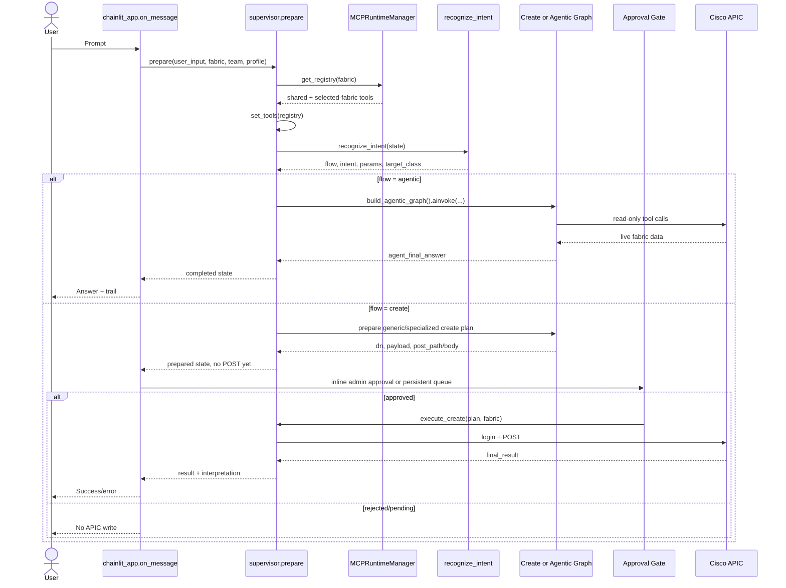
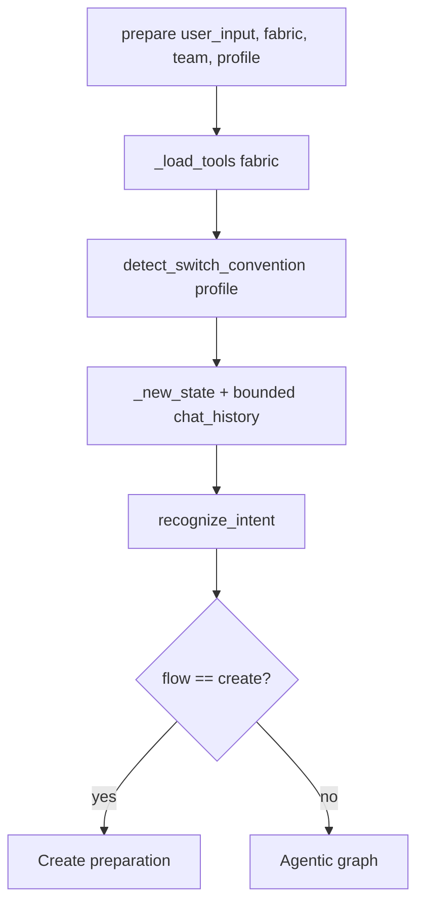
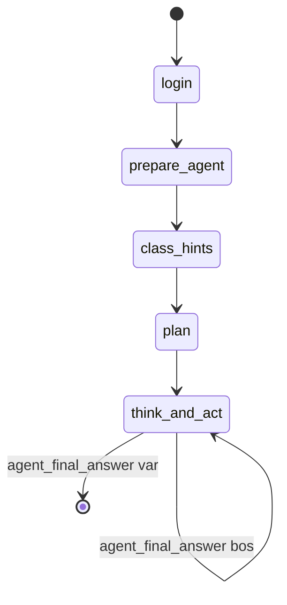
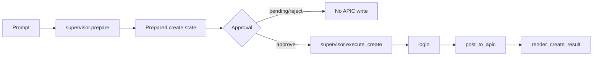
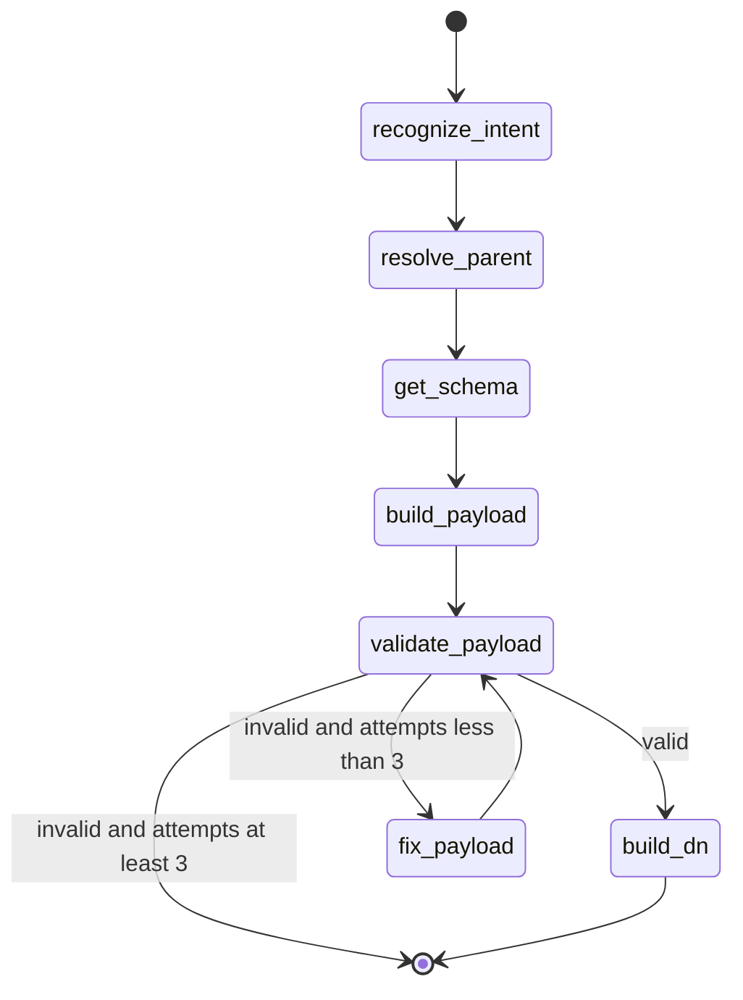
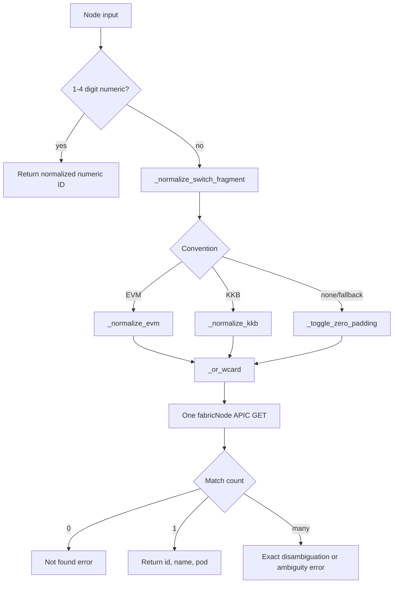
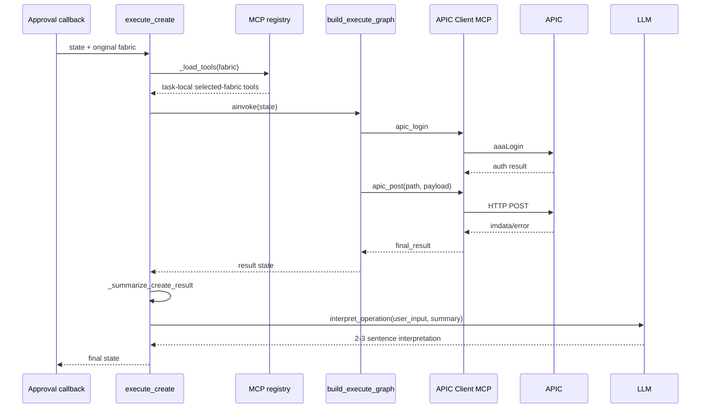

# Prompt Isleme ve Fonksiyon Akislari

Bu dokuman, bir prompt Chainlit'e ulastigi andan kullanici cevabi uretilene kadar
hangi fonksiyonlarin hangi sirayla calistigini anlatir. Genel bilesen mimarisi ve
kalici MCP runtime'in sinif tasarimi icin [ARCHITECTURE.md](ARCHITECTURE.md)
dosyasina bakiniz.

Kullanici olusturma ve parola uretme bu dokumanin kapsaminda degildir.

## 1. Tek Bakista Prompt Akisi



## 2. Chainlit Mesaj Giris Noktasi

Ana giris `chainlit_app.on_message(message)` fonksiyonudur.

### 2.1 Session degerlerini alma

Fonksiyon once su degerleri okur:

```text
fabric   <- cl.user_session["fabric"]
role     <- cl.user_session["role"] (default: user)
username <- _username()
text     <- trim(message.content)
team     <- cl.user_session["team"]
profile  <- cl.user_session["chat_profile"]
history  <- cl.user_session["chat_history"] (son 10 tamamlanmis turn)
```

`fabric`, prompt'un hangi APIC MCP subprocess/session'i uzerinden calisacagini
belirler. `team`, port isimlerine otomatik prefix eklenmesinde; `profile`, switch
isim konvansiyonunun EVM veya KKB olarak algilanmasinda kullanilir.
Yeni chat'te history bos baslatilir. Resume edilen chat'te `thread["steps"]`
icindeki root user/assistant mesajlarindan yeniden kurulur. Tool step'leri,
approval/status komutlari, acilis mesaji ve tamamlanmamis turn'ler dislanir.

### 2.2 Ozel komutlar

Normal intent akisindan once iki komut grubu kontrol edilir:

- Admin queue komutlari (`approvals`, `pending`, `queue`, ...): Admin ise
  `show_pending_queue()`, degilse yetki mesaji. Fonksiyon burada `return` eder.
- Kendi talepleri (`my requests`, `requests`, ...):
  `show_my_requests(username)` calisir ve fonksiyon `return` eder.

Bu komutlarda LLM, LangGraph, MCP veya APIC cagrisi yapilmaz.

### 2.3 Normal istek

Normal prompt icin:

```python
state = await prepare_request(
   message.content,
   fabric,
   team=team,
   profile=profile,
   chat_history=history,
)
```

`prepare_request`, `orchestrator.supervisor.prepare` alias'idir. Donen state'in
`flow`, `errors`, `trail` alanlari okunur. Lokal `send_answer()` cevabi gonderir;
`trail` varsa Chainlit'te `Steps` isimli bir tool step'i olarak ekler.
Normal turn terminal bir cevap urettiginde user/assistant exchange session
buffer'ina bir kez eklenir ve en eski turn atilarak limit 10'da tutulur.

Sonucun render kurali:

| Kosul | Davranis |
|---|---|
| `errors` var, flow agentic degil | Problem listesi gosterilir |
| `flow == agentic` | `agent_final_answer` ve agent adim sayisi gosterilir |
| `flow == unknown` | Istegin anlasilamadigi belirtilir |
| `flow == create`, DN yok | Plan hazirlanamadigi belirtilir |
| `flow == create`, DN var | Admin inline onayina veya kalici queue'ya gider |

## 3. `supervisor.prepare()` Ortak Baslangici

Her normal prompt su sirayi izler:



### 3.1 `_load_tools(fabric)`

1. `get_runtime_manager()` process-local singleton manager'i dondurur.
2. `MCPRuntimeManager.get_registry(fabric)` cagrilir.
3. Manager secilen fabric'in `apic_client` runtime'ini `_get_fabric()` ile alir.
4. Shared `aci_kb + skills` runtime'ini `_get_shared()` ile alir.
5. Her ikisinin session-bound tool'lari yeni bir dict'te birlestirilir.
6. In-process `aci_lookup_class` tool'u eklenir.
7. `set_tools(registry)` registry'yi mevcut request'in `ContextVar`'ina yazar.

Bu noktadan sonra graph node'lari tool nesnesini parametre olarak tasimaz;
`get_tool(name)` veya `get_all_tools()` ile request'e ait registry'den okur.

Tipik registry:

```text
aci_get_mo_spec
aci_validate_payload
aci_build_dn
list_skills
read_skill
apic_login
apic_get
apic_post
apic_delete
aci_lookup_class
```

### 3.2 `recognize_intent(state)`

1. `get_llm()` lazy singleton LLM client'i alir.
2. `INTENT_SYSTEM_PROMPT`, son 10 history turn'u ve en sonda mevcut
   `user_input`, `llm.ainvoke()` ile modele verilir.
3. `extract_json_from_llm(response.content)` cevabi JSON'a cevirir.
4. Basariliysa `intent`, `flow`, `params`, `target_class` ve `trail` doner.
5. Parse basarisizsa hata state'e yazilir ve **agentic** guvenli fallback'i
   secilir. Bozuk bir create JSON'u write'a donusturulmez.
6. History varken classifier create donse bile mevcut prompt explicit bir write
   fiili icermiyorsa sonuc agentic'e cekilir. Eski bir write veya approval,
   "yes/do that" gibi belirsiz bir turn'u yazmaya yetkilendiremez.

Intent classifier'in karari:

| Flow | Intent'ler |
|---|---|
| `create` | `create_tenant`, `create_bd`, `bind_epg`, `bind_vmm_domain`, `define_port`, `copy_epg_bindings`, `copy_port_definition` |
| `agentic` | Bunlar disindaki read, list, count, lookup, why/how, health ve troubleshooting istekleri |

### 3.3 `_new_state(user_input)`

Yeni graph state'i asagidaki baslangic degerleriyle kurar:

```python
{
    "user_input": user_input,
    "errors": [],
    "trail": [],
    "validation_attempts": 0,
    "agent_messages": [],
    "agent_iterations": 0,
   "chat_history": normalize_chat_history(chat_history),
}
```

### 3.4 `detect_switch_convention(profile)`

- Profil adi `EVM` ile basliyorsa `evm`,
- `KKB` ile basliyorsa `kkb`,
- aksi durumda `None`

dondurur. Bu deger yalnizca switch adiyla gelen create port/binding islemlerinde
normalizasyon yardimcilarina iletilir.

## 4. Agentic Akis: Read ve Troubleshooting

Create olmayan her istek icin `prepare()` su islemi yapar:

```python
initial.update(intent_state)
result = await build_agentic_graph().ainvoke(
    initial,
    config={"recursion_limit": MAX_AGENT_ITERATIONS + 12},
)
result["flow"] = "agentic"
```

### 4.1 Graph node sirasi



Graph `graph_agentic.build_agentic_graph()` tarafindan her cagri icin compile
edilir. `agent_router(state)`, `agent_final_answer` varsa `done`, yoksa
`continue` dondurur.

### 4.2 Node 1: `agent_login(state)` -> `login(state)`

`agent_login()` dogrudan ortak `login()` fonksiyonunu cagirir:

1. `get_tool("apic_login")` secili fabric'in tool'unu alir.
2. `tool.ainvoke({})` MCP session uzerinden APIC Client MCP'ye gider.
3. Server `get_client().login(force=True)` cagirir.
4. MCP sonucu `unwrap_mcp_result()` ile Python dict'e cevrilir.
5. Format veya login hatasi `errors` alanina; basari `trail` alanina yazilir.

MCP subprocess ve `APICClient` kalicidir; ancak bu explicit `apic_login` tool'u
server tarafinda `force=True` kullandigi icin graph basinda yeniden authentication
ister. APIC GET/POST metotlarinin kendi otomatik lazy/TTL login mekanizmasi da
ayrica mevcuttur.

### 4.3 Node 2: `prepare_agent(state)`

Bu node agentin system context'ini bir kez kurar:

1. `get_all_tools()` ile request registry'sini alir.
2. `_format_tools_for_prompt()` tool adlarini ve aciklamalarinin ilk satirini
   system prompt'a uygun listeye cevirir.
3. `_load_relevant_skills(user_input)` ile skill routing yapar.
4. UTC zamani ekler; boylece "son 6 saat" gibi filtrelerde model somut zaman
   uretebilir.
5. `AGENT_SYSTEM_PROMPT + skill block + available tools + UTC time` bir
   `SystemMessage` olur.
6. Son 10 history turn'u sirali `HumanMessage` / `AIMessage` olarak eklenir.
7. Mevcut kullanici prompt'u son `HumanMessage` olarak eklenir.
8. Agent sayaçlari, called listesi, observation listesi ve empty streak sifirlanir.

Onceki turn'un plan, tool sonucu, correction mesaji, counter, trail veya error
alanlari history'ye girmez. Bunlar `agent_messages` icinde sadece mevcut graph
invocation'i boyunca yasar; conversation memory icin graph checkpointer yoktur.

#### Skill routing ayrıntısı

`_load_relevant_skills()` sırası (progressive disclosure):

1. Registry'den `list_skills` alınır.
2. `list_skills.ainvoke({})` Skills MCP'deki mevcut TÜM Markdown'ların adı +
   tek satır özetini döndürür; bu liste HER turda koşulsuz system prompt'a
   eklenir (Level 1 — ucuz, her zaman gösterilir, hiçbir tam metin yok).
3. `_score_skills(user_input)`, `_SKILL_KEYWORDS` ile keyword hit sayısını
   hesaplar (İngilizce, coarse bir heuristic).
4. Skoru `SKILL_MATCH_THRESHOLD` (mevcut değer 1) veya üstünde olan skill'ler
   listenin yanına "Non-binding keyword hint" satırı olarak eklenir — bu
   BAĞLAYICI DEĞİLDİR, sadece bir öneri.
5. Hiçbir skill'in tam içeriği burada yüklenmez. Agent, think/act döngüsünde
   kendi karar verip `read_skill(name)` çağırır (Level 2 — istek üzerine).
6. Hiçbir skill uymuyorsa agent, kendi özetinden "ne zaman kullanılır"
   bilgisini görüp `generic_investigation` skill'ini aynı yoldan okur.
7. Keyword ile eşleşen (advisory) skill'ler `selected_skills` state alanına
   yazılır — bunlar "zaten yüklendi" değil, sadece bir ipucudur;
   `inject_class_hints` ve `make_plan` bunu yumuşak bir sinyal olarak kullanır.

Skill'in tam metni artık önceden yüklenmediği için `read_skill` çağrısını
bloklayan bir "already loaded" mekanizması yoktur; normal dedup (`_signature`)
aynı `(tool, arguments)` çiftinin tekrar çalışmasını zaten engeller.

### 4.4 Node 3: `inject_class_hints(state)`

`agentic_aci_kb.py` icinde calisir ve ek LLM cagrisi yapmaz.

- Artik kosulsuz her turda calisir: progressive disclosure altinda hicbir
  skill'in tam metni onceden yuklenmedigi icin (sadece isim+ozet listesi ve
  bagliyici olmayan bir keyword ipucu var), bu BM25 class hint'leri her zaman
  faydali kalir ve atlanmaz.
- `search_classes(user_text, k=6)` in-process BM25 aramasi yapar.
- `_format_hints()` en ilgili ACI class adlarini, label ve kisa aciklamalari bir
  `SystemMessage` olarak agent context'ine ekler.
- Sonuclar `aci_kb.retrieval` logger'ina yazilir.

Agent class'tan emin degilse registry'ye `_load_tools()` tarafindan eklenen
`aci_lookup_class(query)` tool'unu kullanabilir. Bu tool once exact schema icin
`get_mo_spec()`, bulunamazsa `search_classes()` cagirir; MCP hop yapmaz.

### 4.5 Node 4: `make_plan(state)`

Her agentic turn'de tam bir kez calisir:

1. Son kullanici sorusunu alir.
2. Varsa class hint SystemMessage'ini bulur.
3. Tool adlarini tek satirda toplar.
4. Varsa selected skill title'larini ekler.
5. `PLAN_SYSTEM_PROMPT` ile LLM'den 3-5 maddelik, read-only, kanit ve stop
   condition iceren kisa plan ister.
6. Plani yeni `SystemMessage` olarak agent context'ine ekler.

LLM hatasi veya bos cevap graph'i durdurmaz; plan atlanir ve trail'e nedeni
yazilir. Loop edge `think_and_act` node'unun kendisine dondugu icin plan tekrar
uretilmez.

### 4.6 Node 5: `think_and_act(state)` dongusu

Her iterasyonda:

1. Iteration bir artirilir.
2. Limit kontrol edilir (`MAX_AGENT_ITERATIONS = 30`).
3. `llm.ainvoke(agent_messages)` cagrilir.
4. Cevap `extract_json_from_llm()` ile action JSON'a cevrilir.
5. Action `tool_call` veya `final_answer` olarak islenir.

Modelin beklenen ciktilari:

```json
{"action": "tool_call", "tool": "apic_get", "arguments": {"path": "/api/node/class/fvBD.json"}}
```

veya:

```json
{"action": "final_answer", "answer": "..."}
```

#### `final_answer`

`agent_final_answer`, model cevabi, iteration ve trail state'e yazilir.
`agent_router()` graph'i bitirir.

#### `tool_call`

Tool calismadan once korumalar uygulanir:

1. Tool registry'de yoksa available tool listesi modele hata mesaji olarak eklenir.
2. Tool `apic_post` veya `apic_delete` ise calistirilmaz; modele write'in approval
   akisina ait oldugu bildirilir.
3. `_signature(tool_name, arguments)` daha once `agent_called` icindeyse exact
   duplicate calistirilmaz.
4. Ayni path+filter ailesi (`page` haric) daha once **LARGE RESULT**
   (`totalCount` >= esik) orneklenmisse ek page-only cagrilar engellenir;
   modelden `final_answer` veya daraltilmis filter istenir.

Korumalari gecen tool:

```python
raw_result = await tools[tool_name].ainvoke(arguments)
result = unwrap_mcp_result(raw_result)
```

ile calistirilir. Exception structured `{"error": ...}` sonucuna cevrilir.

Sonra:

- `_is_empty_or_error()` sonucun bos/hata olup olmadigini belirler.
- `_capture_observation()` tool, hedef class/MO, total, returned ve error
  alanlarindan kisa kanit kaydi uretir.
- `_format_tool_result()` APIC `totalCount` degerini basa koyar, JSON'u compact
  eder ve 24 KB sinirini asarsa objeleri tam obje sinirinda azaltir. Buyuk
  `totalCount` veya kisaltilmis body icin "LARGE RESULT: kalan sayfalari
  cekme" yonlendirmesi eklenir.
- Tool action'i `AIMessage`, sonucu `HumanMessage` olarak context'e eklenir.
- Graph tekrar `think_and_act` node'una doner.

`agent_called`, `agent_empty_streak` ve `agent_large_query_families`
`GraphState` alanlaridir (plain last-write); `prepare_agent` her turda sifirlar,
`think_and_act` iterasyonlar arasi biriktirir. Bu alanlar state'te tanimli
olmazsa LangGraph anahtarlari duser ve dedup/fail-fast/page-chase sifirlanir.

#### Loop korumalari

| Koruma | Davranis |
|---|---|
| Exact duplicate | Tool calistirilmaz, farkli class/filter istenir |
| Page-chase (buyuk sonuc ailesi) | Ayni path+filter icin ek page ilerletme engellenir |
| 3 ardisik bos/hata (veri bulunduysa 5) | Sorgu durur; `_synthesize_final_answer()` o ana kadar gelen TUM sonuclari tek LLM cagrisiyla yorumlar, hepsi bossa "bulamadim" der |
| 30 adim | Ayni sentez yapilir; LLM hata verirse `_max_iter_fallback()` deterministik ozet uretir |
| Bozuk JSON action | En fazla 2 kez modele sadece duzeltilmis JSON'u yeniden basmasi soylenir |
| Plain prose | JSON action'a benzemiyorsa dogrudan final answer kabul edilir |
| Write tool | Kesinlikle calistirilmaz |

### 4.7 Agentic cevabin UI'a donmesi

Graph sonucu `prepare()` tarafindan `flow="agentic"` ile doner. `on_message()`:

1. `agent_final_answer` alanini alir.
2. Cevabi ek bir agent-step sayisi eklemeden `send_answer()` ile yollar.
3. `trail` adimlarini mesaja bagli `Steps` panelinde gosterir.

## 5. Create Akisinin Ortak Mantigi

Create iki asamalidir:

1. **Prepare:** APIC'e yazmadan plan, DN ve payload/body olusturulur.
2. **Execute:** Yalnizca onaydan sonra login ve POST yapilir.



Create intent'leri iki gruptur:

- **Genel schema-driven:** `create_tenant`, `create_bd`.
- **Ozel deterministik builder:** `bind_epg`, `bind_vmm_domain`, `define_port`,
  `copy_port_definition`, `copy_epg_bindings`.

Ozel builder'lar karmasik ACI tree payload'larini Python ile deterministik kurar;
payload olusturmak icin LLM kullanmaz. LLM yalnizca ilk intent/parametre cikarmada
kullanilir.

## 6. Genel Create: Tenant ve BD

`prepare()` ozel intent'lerden biri degilse:

```python
result = await build_prepare_graph().ainvoke(initial)
result["flow"] = "create"
```

cagirir.

Onemli ayrinti: `supervisor.prepare()` intent'i yonlendirme icin bir kez zaten
tanir. `build_prepare_graph()` giris node'u da `recognize_intent` oldugu icin
tenant/BD hazirliginda intent classifier ikinci kez calisir.

### 6.1 Prepare graph sirasi



### 6.2 `resolve_parent(state)`

- `create_bd`: `params.tenant` zorunludur ve `parent_dn = uni/tn-<tenant>`
  uretilir.
- Diger create: bos `parent_dn` dondurur.
- Tenant eksikse `errors` ve trail yazar.

### 6.3 `get_schema(state)`

1. `target_class` yoksa hata dondurur.
2. `get_tool("aci_get_mo_spec")` shared ACI KB tool'unu alir.
3. `ainvoke({"class_name": target_class})` ile schema ister.
4. `unwrap_mcp_result()` ile sonucu acar.
5. Schema `state.schema` alanina yazilir.

Bu adim APIC'e gitmez; local ACI knowledge base MCP subprocess'inde calisir.

### 6.4 `build_payload(state)`

Schema'nin class adi, description'i, naming/mandatory property'leri ve intent
classifier'in `params` degerleri LLM'e verilir. Modelden wrapper'siz, flat JSON
attribute dict istenir. `extract_json_from_llm()` sonucu parse eder ve
`state.payload` alanina yazar.

### 6.5 `validate_payload(state)`

1. `aci_validate_payload` MCP tool'u `class_name + payload` ile cagrilir.
2. Sonuc `validation_result` alanina yazilir.
3. `validation_attempts` bir artirilir.
4. `validation_router()` sonucu degerlendirir:
   - `valid=True` -> `build_dn`,
   - invalid ve attempts < 3 -> `fix_payload`,
   - invalid ve attempts >= 3 -> graph sonu.

### 6.6 `fix_payload(state)`

Schema, mevcut payload ve validator error listesi LLM'e verilir. Modelden unknown
property'leri cikarmasi, enum/yes-no degerlerini duzeltmesi ve eksik required
alanlari eklemesi istenir. Duzenlenen payload tekrar `validate_payload` node'una
gider.

### 6.7 `build_dn(state)`

1. Schema'daki `naming_properties` adlari cikarilir.
2. Yalnizca bu adlarin payload degerleri `naming_values` olur.
3. Varsa `parent_dn` eklenir.
4. `aci_build_dn` MCP tool'u cagrilir.
5. Basarili DN `state.dn` alanina yazilir.

Prepare graph burada biter; login veya POST yapmaz.

## 7. Ozel Create: EPG Static Binding

Intent `bind_epg` ise `prepare()` dogrudan
`_build_binding(params, user_input)` cagirir.

### 7.1 Parametre normalizasyonu

- `params.epgs` yoksa tek `params.epg` listeye cevrilir.
- `params.bindings` yoksa `node`, `port`, `node2`, `policy_group`, `vpc`,
  `serial`, `name` alanlarindan tek binding kurulur.
- Mode yoksa `regular` varsayilir.
- EPG veya binding yoksa plan hata state'i olarak doner.

### 7.2 Her EPG'yi cozme

Her EPG icin sirayla:

1. `resolve_epg_location(name)`:
   - Gerekirse `apic_login`,
   - `/api/node/class/fvAEPg.json` uzerinde exact name filter,
   - DN'den tenant/application-profile/EPG parse eder.
2. Sifir match hata, birden cok match ambiguity hatasidir.
3. `resolve_epg_encap(tenant, ap, epg, user_encap)` VLAN'i su oncelikle cozer:
   - kullanicinin explicit VLAN'i,
   - EPG adinin son `_NNN` parcasi,
   - `_resolve_epg_static_encap()` ile mevcut `fvRsPathAtt`,
   - `_resolve_epg_vlan_pool_encap()` ile tek VLAN'li VMM pool.

Her cozum `epg_specs = {tenant, ap, epg, encap}` listesine eklenir.

### 7.3 Node ve port referanslarini cozme

- Binding `node`/`node2` numeric degilse `resolve_node_name()` ile `fabricNode`
  sorgulanir ve numeric ID yazilir.
- `_resolve_port_bindings()` explicit node+port'u oldugu gibi tutar.
- Yalniz serial/name verilen kayitta `nodes_port.resolve_port_ref()` cagrilir.
- Bir access profile birden cok leaf/porta bagliysa tek referans birden cok tDn'e
  acilir. PC/vPC bir bundle tDn verir.

`resolve_port_ref()` serial/profile icin:

1. `infraAccPortP` adini wildcard ile bulur.
2. Interface profile subtree'sinden `infraPortBlk` ve `infraRsAccBaseGrp` okur.
3. `infraRsAccPortP` ile hangi switch profile'lara bagli oldugunu tersine cozer.
4. `_nodes_of_switch_profile()` ile switch profile'daki `infraNodeBlk` node'larini
   bulur.
5. Access icin `paths-N/pathep-[ethX/Y]`, PC/vPC icin bundle/protpaths tDn'leri
   uretir.

### 7.4 `build_static_binding()`

Butun EPG x butun port cross-product'ini kurar. Mode map:

| Kullanici mode | APIC mode |
|---|---|
| trunk/tagged/regular | `regular` |
| access/untagged | `untagged` |
| native/802.1p | `native` |

Tek atomik APIC body:

```text
polUni
  -> fvTenant
     -> fvAp
        -> fvAEPg
           -> fvRsPathAtt (her tDn icin)
```

Planin `post_path` degeri `/api/node/mo/uni.json`, `post_body` degeri bu tree,
`dn` degeri `uni` olur. Henuz POST yapilmaz.

## 8. Ozel Create: VMM Domain EPG Binding

Intent `bind_vmm_domain` ise `_build_vmm_binding()` calisir.

1. Domain ve binding varligi kontrol edilir.
2. `resolve_vmm_domain_epgs(domain, provider)` cagrilir.
3. Fonksiyon `fvRsDomAtt.tDn == uni/vmmp-<provider>/dom-<domain>` filtresiyle
   domain'e bagli tum EPG'leri bulur.
4. Her EPG icin static binding VLAN'i su sirayla cozulur:
   - mevcut static binding,
   - EPG adi VLAN suffix'i,
   - domain VLAN pool'u.
5. Encap'i cozulmeyen EPG'ler `unresolved` listesine alinir ve trail'e yazilir.
6. Node adlari `resolve_node_name()`, serial portlar `resolve_port_ref()` ile
   cozulur.
7. `build_static_binding()` tum cozulmus domain EPG'lerini tum hedef portlara
   bind edecek atomik plan uretir.

## 9. Ozel Create: Port Definition

Intent `define_port` ise `_build_port(params, user_input, team, convention)`
calisir.

### 9.1 Kontrol ve cozum

1. `port_type` yalnizca `access`, `pc`, `vpc` olabilir.
2. Node listesi normalize edilir.
3. vPC tam 2, PC tam 1 node gerektirir.
4. `_resolve_node_list()` numeric olmayan her node'u `resolve_node_name()` ile
   cozer.
5. Team varsa ve name `TEAM_` ile baslamiyorsa otomatik team prefix eklenir.
6. Explicit `switch_profile` yoksa `resolve_switch_profile(nodes)` cagrilir.
   Multi-node access icin her node'un profili ayri cozulur.

`resolve_switch_profile()` once login yapar, tum `infraNodeBlk` kayitlarini okur
ve istenen node araligini tam kapsayan tek `infraNodeP` adini DN'den cikarir.
Sifir veya birden cok match hata kabul edilir.

### 9.2 `build_port_definition()`

Port policy adlarini su oncelikle belirler:

1. Prompt'ta explicit override,
2. `PORTDEF_*` environment override,
3. `PORT_DEF_POLICIES` standard/empty modu.

Naming `PORT_DEF_NAMING` degerine gore kurulur. Her port metni `_parse_port()`
ile card/port/subport'a ayrilir. Tek atomik tree uretilir:

```text
infraInfra
  -> infraFuncP
     -> infraAccPortGrp veya infraAccBndlGrp
        -> CDP/LLDP/link/storm/STP/LACP/AEP relations
  -> infraAccPortP
     -> infraHPortS
        -> infraPortBlk
        -> infraRsAccBaseGrp
  -> infraNodeP
     -> infraRsAccPortP
```

POST path `/api/node/mo/uni/infra.json` olur. PC icin `lagT=link`, vPC icin
`lagT=node` kullanilir.

## 10. Ozel Create: Port Definition Kopyalama

Intent `copy_port_definition` ise `_build_copy_port()` calisir.

1. Yeni name, source, node ve port varligi kontrol edilir.
2. Team prefix gerekiyorsa eklenir.
3. `read_port_template(source)` kaynak portu okur:
   - `infraAccPortP` wildcard lookup,
   - profile subtree'den policy-group tDn,
   - policy group subtree'den access/PC/vPC tipi,
   - AEP, CDP, LLDP, link-level, storm, STP ve LACP policy adlari.
4. Yeni node sayisinin kaynak port tipiyle uyumu kontrol edilir.
5. Node adlari ve switch profile cozulur.
6. Kaynaktan okunan `port_type`, AEP ve policy'ler yeni name/node/port ile
   `build_port_definition()` fonksiyonuna verilir.

Bu islem kaynak portu degistirmez; ayni policy zincirine sahip yeni bir port
definition tree'si kurar.

## 11. Ozel Create: EPG Binding Kopyalama

Intent `copy_epg_bindings` ise `_build_copy_bindings()` calisir.

1. Source tek port, `destinations` bir LISTEDIR (10-15+ hedef olabilir; eski
   tekil `destination` da kabul edilir). Ikisi de zorunludur.
2. Ic node/node2 adlari `resolve_node_name()` ile cozulur.
3. `resolve_port_ref(source)` kaynak tDn veya tDn'leri bulur.
4. Her kaynak path icin `read_bindings_on_path(tdn)` cagrilir:
   - `fvRsPathAtt.tDn == source` filtresi,
   - DN'den tenant/ap/epg,
   - attribute'lardan encap ve mode.
5. Duplicate binding spec'leri set ile tekillestirilir.
6. Her hedef icin `resolve_port_ref()` tDn veya tDn'leri bulur. Cozulemeyen,
   kaynakla ayni olan veya tekrar eden hedef atlanir ve plan payload'inda
   `skipped_destinations` olarak gosterilir; hicbir hedef cozulemezse islem
   reddedilir.
7. `build_copy_bindings(specs, dst_tdns, ...)` her kaynak binding'i her hedef
   path icin korunan encap/mode ile tek atomik `polUni` POST'una cevirir.
   Onay ekranindaki payload ozet halindedir (binding listesi + hedef listesi).

Kopyalama additive merge'dir; hedefteki mevcut binding'leri silmez.

## 12. Switch Adi Cozme Detayi

`resolve_node_name(name_input, convention)` bircok create helper'i tarafindan
ortak kullanilir.



- `_frag_tokens()`: Bosluk, slash ve tire gibi separator'lari normalize eder.
- `_normalize_evm()`: `<LEFT>-C<nn>-<nn>` formu ve padding varyantlari.
- `_normalize_kkb()`: `A1-<middle>-<nn>` formu ve parcali sayilari birlestirme.
- `_toggle_zero_padding()`: Genel 1-2 digit segment varyantlari.
- `_or_wcard()`: Tum varyantlari tek nested `or(wcard(...), ...)` filter'a koyar.

Boylece padding varyanti basina ayri APIC GET yerine tek sorgu yapilir.

## 13. Approval Gate

Create prepare sonucu UI'a geldiginde `_plan_text(state)` type, DN ve payload'i
gosterilebilir metne cevirir.

### 13.1 Admin'in kendi istegi

`handle_admin_approval(state, plan_text, fabric)`:

1. Approve/Reject action'lariyla `AskActionMessage` gosterir.
2. 300 saniye timeout'ta iptal eder.
3. Reject'te hicbir APIC cagrisi yapmaz.
4. Approve'da `execute_create(state, fabric)` cagirir.
5. `render_create_result()` sonucu gosterir.

### 13.2 Normal kullanici istegi

1. `_curate_plan(state)` yalnizca execution icin gereken alanlari ayirir.
2. `approvals.create(...)` plani SQLite'a `pending` olarak yazar.
3. Admin e-postalari varsa `send_email()` ile bildirim gonderilir.
4. Turn biter. Bekleyen bir coroutine veya LangGraph interrupt yoktur.

### 13.3 Sonradan admin onayi

Admin `approvals` yazdiginda `show_pending_queue()` kayitlari action'larla listeler.
Approve action'i `on_approve_request(action)` fonksiyonuna gelir:

1. Admin role ve kaydin `pending` oldugu kontrol edilir.
2. `plan_json` parse edilir.
3. Kaydin fabric adi `_fabric_by_name()` ile aktif konfigurasyona cozulur.
4. Fabric artik tanimli degilse execution durur.
5. `execute_create(plan, fabric)` cagrilir.
6. APIC sonucu `_apic_outcome()` ile success/error olarak normalize edilir.
7. `approvals.set_decision()` status/result kaydeder.
8. UI sonucu render edilir ve requester'a e-posta gonderilir.

Deny action'i `on_deny_request()` icinde status'u `denied` yapar; execution
fonksiyonu cagrilmaz.

## 14. Onay Sonrasi Execution

`supervisor.execute_create(state, fabric)` tam sirasi:



### 14.1 Neden tool'lar yeniden load ediliyor?

Prepare ve approval ayni async task'ta olmak zorunda degildir. Kalici queue'daki
plan gunler sonra ve baska admin session'inda calisabilir. Bu nedenle
`execute_create()` state icindeki eski tool nesnelerine guvenmez; verilen fabric
ile `_load_tools()` cagirip dogru ContextVar registry'sini yeniden publish eder.
Manager saglikli runtime'i cache'den verir; normal durumda yeni subprocess acmaz.

### 14.2 `build_execute_graph()`

Graph yalnizca iki node icerir:

```text
login -> post_to_apic -> END
```

`post_to_apic(state)`:

- `post_path` ve `post_body` varsa static binding/port builder'in urettigi atomik
  body'yi aynen kullanir.
- Yoksa genel tenant/BD icin:

```python
path = f"/api/node/mo/{dn}.json"
body = {target_class: {"attributes": payload}}
```

kurar.

Ardindan `apic_post` tool'unu `{"path": path, "payload": body}` ile cagirir ve
sonucu `final_result` alanina yazar.

### 14.3 Sonuc yorumlama

`_summarize_create_result()` top-level `error` veya `imdata[*].error` arar;
basari/hata ozetini uretir. `interpret_operation(user_input, summary)` LLM'den
network engineer icin 2-3 cumlelik kisa yorum alir. Bu yorumlama hata verirse
write sonucu kaybolmaz; `interpretation` bos birakilir.

`render_create_result()` tekrar `_apic_outcome()` ile sonucu kontrol eder ve
success veya APIC error mesaji, DN/type, opsiyonel interpretation ve trail'i
gosterir.

## 15. `run()` ile `prepare()` Farki

`supervisor.run()` Chainlit approval modeli disindaki CLI/dogrudan kullanim
icindir:

- Tool yukleme ve intent tanima aynidir.
- Ozel create builder tamamlaninca dogrudan `build_execute_graph()` cagrilir.
- Genel create icin `build_create_graph()` kullanilir; intent -> payload ->
  validation -> DN -> login -> POST tek graph'ta biter.
- Agentic akis `prepare()` ile aynidir.

`chainlit_app.py` `run()` kullanmaz; guvenli iki asamali `prepare()` +
`execute_create()` modelini kullanir.

## 16. Ortak Yardimci Fonksiyonlar

### MCP ve JSON sonuc yardimcilari

| Fonksiyon | Ayrintili gorev |
|---|---|
| `unwrap_mcp_result()` | MCP content listesi, `.text`, JSON string veya dict sonucunu tek Python degerine normalize eder |
| `_extract_balanced()` | String literal/escape'leri dikkate alarak ilk dengeli JSON object span'ini bulur |
| `_brace_balance()` | String icindeki brace'leri yok sayarak eksik kapanis sayisini hesaplar |
| `extract_json_from_llm()` | Code fence temizler; whole JSON, eksik acilis/kapanis onarimi, balanced object ve array fallback uygular |

### Agentic sonuc yardimcilari

| Fonksiyon | Ayrintili gorev |
|---|---|
| `_signature()` | Tool adi + sorted JSON arguments'tan dedup anahtari yapar |
| `_is_empty_or_error()` | Error, bos imdata, totalCount=0 ve bos Python degerlerini saptar |
| `_format_tool_result()` | totalCount'i korur, compact JSON uretir, buyuk APIC listelerini whole-object sinirinda kisaltir |
| `_capture_observation()` | Fallback icin target/total/returned/error metadatasi tutar |
| `_max_iter_fallback()` | Iteration limitinde yeni LLM cagrisi yapmadan eldeki kanitlari ozetler |
| `_score_skills()` | Keyword overlap ile skill basina advisory (baglayici olmayan) skor hesaplar |

### EPG/VLAN yardimcilari

| Fonksiyon | Ayrintili gorev |
|---|---|
| `_path_tdn()` | Explicit access veya vPC binding dict'inden fabric path tDn kurar |
| `extract_vlan_from_name()` | EPG adinin son underscore segmentinden 1-4094 VLAN bulur |
| `_resolve_epg_static_encap()` | EPG subtree'sindeki mevcut static binding VLAN'ini bulur |
| `_resolve_epg_vlan_pool_encap()` | EPG -> VMM domain -> VLAN namespace -> tek-VLAN encap block zincirini yurur |
| `read_bindings_on_path()` | Bir path'e bagli tum EPG/encap/mode degerlerini okur |
| `build_copy_bindings()` | Kaynak binding'leri hedef path'lerde additive atomik polUni tree'sine cevirir |

### Port yardimcilari

| Fonksiyon | Ayrintili gorev |
|---|---|
| `_naming_mode()`, `_names()` | Prod/test port object adlarini belirler |
| `_policy_defaults()` | Standard/empty ve environment policy degerlerini birlestirir |
| `_parse_port()` | `eth1/47` benzeri ifadeyi card/port/subport olarak parse eder |
| `_expand_port_block()` | `infraPortBlk` range'ini tekil `ethX/Y` listesine acar |
| `_nodes_of_switch_profile()` | `infraNodeP` subtree'sinden kapsanan node ID'lerini bulur |
| `resolve_port_ref()` | Explicit veya serial/profile port referansini gercek static-binding tDn'lerine cevirir |
| `read_port_template()` | Kaynak port tipini, AEP'yi ve policy relation'larini okur |
| `build_port_definition()` | Policy group + interface profile + selector + switch attachment tree'sini kurar |

## 17. Hata ve Trail Davranisi

Node'lar exception firlatmak yerine mumkun oldugunca state parcasi dondurur:

```python
{
    "errors": ["human-readable error"],
    "trail": ["node_name: failure detail"]
}
```

`GraphState.errors` ve `GraphState.trail` listeleri reducer ile birikir. Create
prepare'da error varsa `on_message()` problemi gosterir ve DN yoksa durur.
Agentic tool exception'lari model context'ine structured result olarak girer;
uc ardisik bos/hata (veri bulunduysa bes) fail-fast'i tetikler ve toplanan
kanitlardan son cevap sentezlenir.

MCP runtime startup hatalari farkli davranir:

- Chat baslangicindaki `warm()` hatayi yalnizca loglar.
- Gercek prompt'taki `_load_tools()` ayni hatayi caller'a yukseltir.
- `on_message()` bunu yakalar ve `Unexpected error` mesaji gosterir.

## 18. Ornek Uctan Uca Akislar

### 18.1 "Tum tenant'lari listele"

```text
on_message
  -> prepare
     -> _load_tools(selected fabric)
     -> recognize_intent => agentic
     -> build_agentic_graph
        -> agent_login
        -> prepare_agent (skill preload/generic fallback)
        -> inject_class_hints (gerekiyorsa fvTenant)
        -> make_plan
        -> think_and_act
           -> apic_get /api/node/class/fvTenant.json
           -> think_and_act
           -> final_answer
  -> send_answer + Steps trail
```

### 18.2 "PROD tenant'inda WEB-BD olustur"

```text
on_message
  -> prepare
     -> _load_tools
     -> recognize_intent => create_bd
     -> build_prepare_graph
        -> recognize_intent (ikinci kez)
        -> resolve_parent => uni/tn-PROD
        -> get_schema(fvBD)
        -> build_payload(LLM)
        -> validate_payload [-> fix_payload -> validate, gerekirse]
        -> build_dn => uni/tn-PROD/BD-WEB-BD
  -> approval gate
  -> execute_create (yalnizca approve)
     -> _load_tools(original fabric)
     -> login
     -> post_to_apic
     -> _summarize_create_result
     -> interpret_operation
  -> render_create_result
```

### 18.3 "VLAN_109 EPG'sini MSY_CX124553KT porta trunk bind et"

```text
on_message
  -> prepare
     -> _load_tools
     -> recognize_intent => bind_epg
     -> _build_binding
        -> resolve_epg_location
        -> resolve_epg_encap (EPG suffix => 109)
        -> _resolve_port_bindings
           -> resolve_port_ref(serial)
              -> infraAccPortP lookup/subtree
              -> switch-profile reverse lookup
              -> path tDn listesi
        -> build_static_binding
  -> approval gate
  -> execute_create
     -> login
     -> post_to_apic(/api/node/mo/uni.json, polUni tree)
  -> render_create_result
```

### 18.4 Iki fabric'ten es zamanli iki prompt

```text
Request A / Fabric 1
  -> registry = shared tools + Fabric 1 apic tools
  -> ContextVar A
  -> apic_get => Fabric 1 session/subprocess

Request B / Fabric 2
  -> registry = shared tools + Fabric 2 apic tools
  -> ContextVar B
  -> apic_get => Fabric 2 session/subprocess
```

Shared ACI KB/Skills session'lari aynidir; APIC session'lari farklidir. Registry
global olarak pool edilmedigi ve ContextVar request-local oldugu icin Fabric 1'in
`apic_get` tool'u Fabric 2 istegine sizmaz.