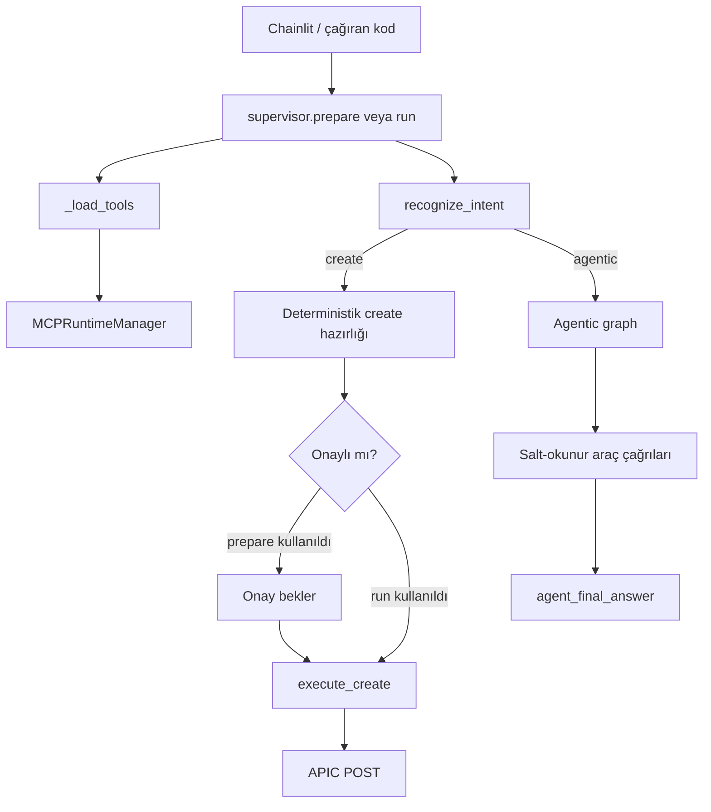
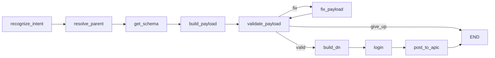
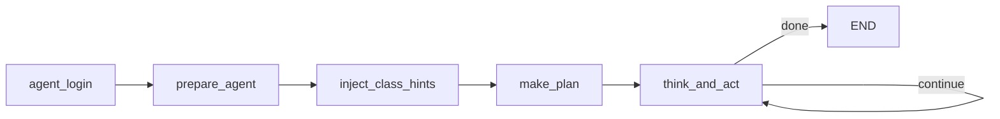
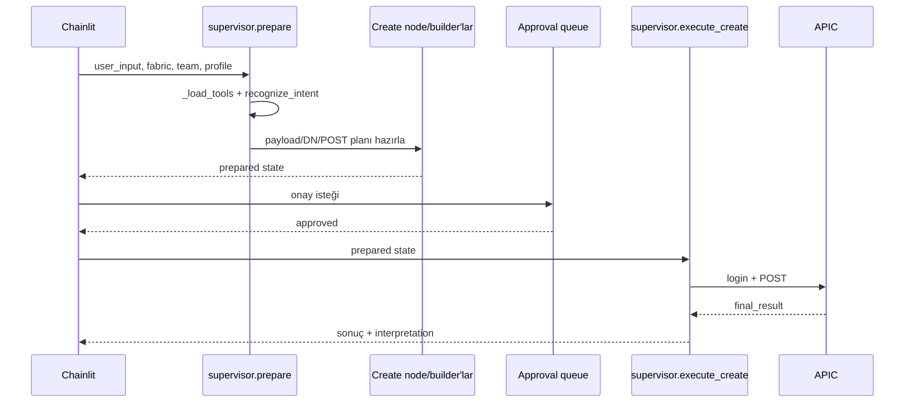
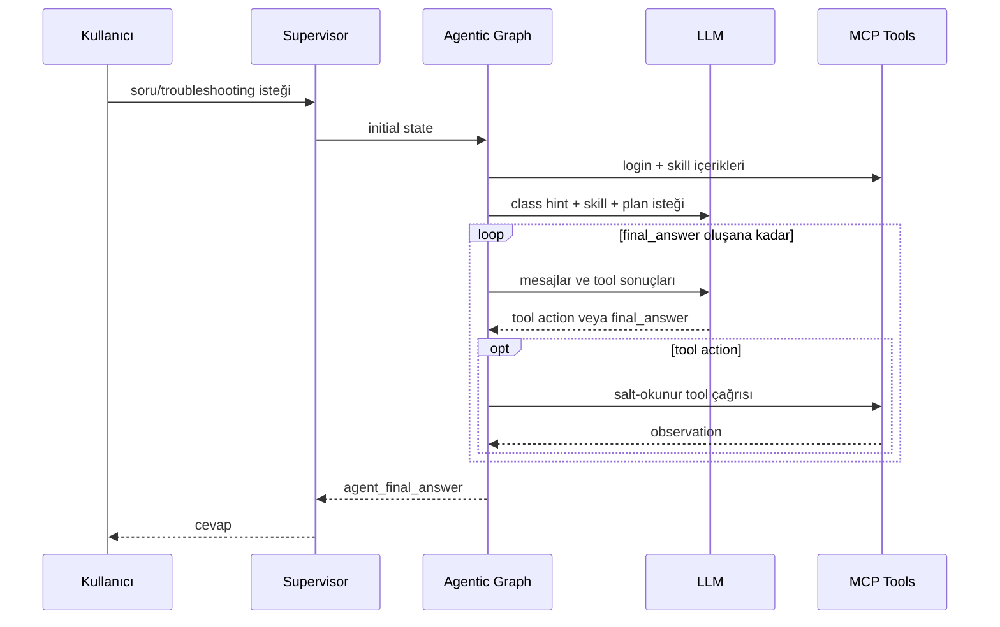

# Orchestrator Fonksiyon Rehberi

Bu belge `langgraph-orchestrator/orchestrator/` paketindeki modülleri, sınıfları,
fonksiyonları ve temel çağrı akışlarını açıklar. Özel yardımcılar (`_` ile
başlayanlar) dahil edilmiştir.

## 1. Genel Mimari

Orchestrator iki ana çalışma biçimine sahiptir:

1. **Deterministik create akışı:** Tenant/BD oluşturma, EPG bağlama ve port
   tanımlama gibi yazma işlemlerini doğrulanabilir bir payload'a dönüştürür.
   Chainlit kullanıldığında işlem önce hazırlanır, onaydan sonra APIC'e yazılır.
2. **Agentic akış:** Listeleme, arama, inceleme ve troubleshooting isteklerinde
   LLM'in uygun salt-okunur araçları adım adım çağırdığı ReAct benzeri döngüdür.

Araçlar MCP sunucularından gelir. MCP süreçleri `mcp_runtime.py` tarafından
kalıcı tutulur; o isteğe ait araç registry'si `ContextVar` üzerinden graph
node'larına ulaştırılır.

## 2. `state.py`

LangGraph node'ları arasında taşınan ortak state sözleşmesini tanımlar.

### `GraphState`

`TypedDict(total=False)` sınıfıdır; her alanın her aşamada bulunması gerekmez.

- İstek ve sınıflandırma: `user_input`, `intent`, `params`, `target_class`,
  `flow`.
- Deterministik create: `schema`, `payload`, `dn`, `parent_dn`,
  `validation_result`, `validation_attempts`, `post_path`, `post_body`.
- Agentic akış: `agent_messages`, `chat_history`, `agent_iterations`,
  `agent_final_answer`, `agent_malformed_retries`, `agent_called` (exact-call
  dedup imzaları), `agent_empty_streak`, `agent_observations`,
  `agent_large_query_families` (LARGE RESULT sonrası page-chase engeli),
  `selected_skills`.
- Ortak sonuç: `final_result`, `interpretation`, `errors`, `trail`.

`agent_messages` alanındaki `Annotated[list, add]`, LangGraph'e node çıktılarının
mevcut mesaj listesinin üzerine eklenmesi gerektiğini bildirir.
`agent_called` / `agent_empty_streak` / `agent_large_query_families` plain
last-write alanlardır; `GraphState`'te tanımlı olmaları gerekir, aksi halde
LangGraph anahtarları düşürür ve loop korumaları her adımda sıfırlanır.

## 3. `mcp_runtime.py`

MCP stdio süreçlerini her istek için yeniden başlatmak yerine kalıcı oturumlar
olarak yönetir. Shared sunucular (`aci_kb`, `skills`) bütün fabric'lerde
ortaktır; `apic_client` her fabric için ayrıdır.

### `_shared_connections() -> dict`

Ortam değişkenlerinden `aci_kb` ve `skills` MCP sunucu konfigürasyonlarını
üretir. Sonuç `MultiServerMCPClient` bağlantı sözlüğü formatındadır.

### `_fabric_connection(fabric: dict) -> dict`

Verilen fabric kaydındaki Python executable ve server dosyasını kullanarak
yalnız o fabric'e ait `apic_client` bağlantısını üretir.

### `_fabric_key(fabric: dict)`

Fabric runtime'ını cache'lemek için kararlı anahtar üretir. Öncelikle fabric
kimliğini, yoksa adını kullanır. Böylece aynı fabric için tek kalıcı runtime
tutulur.

### `_Runtime`

Tek bir `MultiServerMCPClient` oturum grubunun yaşam döngüsünü sahiplenen özel
sınıftır. AnyIO cancel-scope'un açıldığı task'ta kapanması gerektiği için bütün
session yaşam döngüsü uzun yaşayan bir owner task içinde tutulur.

#### `_Runtime.__init__(name, connections)`

Runtime adını ve MCP bağlantılarını kaydeder; ready/closing event'lerini,
owner task referansını, tool registry'sini ve hata alanını başlatır.

#### `async _Runtime._owner()`

Asıl yaşam döngüsüdür:

1. MCP client session'larını açar.
2. Sunuculardaki araçları yükleyip ada göre registry oluşturur.
3. Runtime'ın hazır olduğunu işaretler.
4. `_closing` event'i gelene kadar task'ı açık tutar.
5. Çıkışta session context'lerini aynı task içinde kapatır.

Başlangıç hatasını `_error` alanına yazar ve bekleyen `start()` çağrısını
uyandırır.

#### `async _Runtime.start(timeout=60)`

Owner task'ı başlatır ve runtime hazır olana kadar timeout ile bekler. Startup
hatası veya timeout oluşursa `RuntimeError` yükseltir.

#### `_Runtime.healthy() -> bool`

Owner task hâlâ çalışıyor, startup hatası yok ve registry boş değilse `True`
döndürür. Bu hızlı bir liveness kontrolüdür.

#### `_Runtime.tools() -> dict`

Registry'nin kopyasını döndürür. Kopya dönmesi, çağıranın runtime'a ait asıl
sözlüğü yanlışlıkla değiştirmesini engeller.

#### `async _Runtime._cancel()`

Owner task'ı iptal eder ve shutdown sırasında beklenen cancellation
istisnalarını bastırır. Hata/yarım başlangıç cleanup yoludur.

#### `async _Runtime.close()`

`_closing` event'ini set eder ve owner task'ın session'ları düzgün kapatarak
bitmesini bekler.

### `MCPRuntimeManager`

Bir shared runtime ile fabric başına bir runtime'ı koordine eder. Lazy startup
ve lock kullanımı aynı runtime'ın eşzamanlı olarak iki kez açılmasını önler.

#### `MCPRuntimeManager.__init__()`

Shared runtime, fabric runtime sözlüğü ve bunlara ait async lock'ları başlatır.

#### `async MCPRuntimeManager._get_shared()`

Shared runtime sağlıklıysa onu döndürür. Değilse lock içinde tekrar kontrol
eder, eski runtime'ı temizler ve yenisini başlatır.

#### `async MCPRuntimeManager._get_fabric(fabric)`

`_fabric_key` ile fabric runtime'ını bulur. Sağlıksız/yoksa fabric'e özel lock
altında yeni `apic_client` runtime'ı açar.

#### `async MCPRuntimeManager.get_registry(fabric) -> dict`

Shared ve fabric runtime'larını hazırlar, registry'lerini birleştirir. İsim
çakışmasında fabric araçları kazanır. Her istek için yeni sözlük döndürür.

#### `async MCPRuntimeManager.warm(fabric)`

Fabric runtime'ını önceden başlatır. Warm-up best-effort'tür; kullanıcı isteğini
bozmamak için hatayı dışarı taşımaz.

#### `async MCPRuntimeManager.aclose()`

Fabric runtime'larını ve shared runtime'ı kapatır; manager cache'lerini temizler.
Uygulama kapanışında çağrılır.

### `get_runtime_manager() -> MCPRuntimeManager`

Modül seviyesindeki manager singleton'ını lazy olarak oluşturup döndürür.

## 4. `nodes_common.py`

LLM erişimi, task-local tool registry, MCP sonuç çözme, intent sınıflandırma ve
switch adı çözümleme gibi ortak işlevleri içerir.

### `get_llm()`

`ChatOpenAI` istemcisini ortam ayarlarıyla ilk çağrıda oluşturur ve modül
seviyesinde cache'ler. Sonraki çağrılar aynı istemciyi kullanır.

### `set_tools(d)`

İsteğe ait tool registry'sini `_tools_var` adlı `ContextVar` içine yazar. Bu
sayede eşzamanlı fabric istekleri birbirinin araçlarını görmez.

### `get_tool(name)`

Aktif registry'den isimle araç döndürür. Araç yoksa açıklayıcı `RuntimeError`
yükseltir.

### `get_all_tools()`

Aktif task'ın bütün araçlarının kopyasını döndürür.

### `unwrap_mcp_result(result)`

MCP adapter'ından gelen farklı sonuç şekillerini ortak Python verisine çevirir.
Text content içindeki JSON'u parse etmeyi dener; JSON değilse metni korur.

### `_extract_balanced(text, open_ch="{", close_ch="}")`

Bir metindeki ilk dengeli JSON object/array bölümünü bulur. String içindeki
brace'leri ve escape karakterlerini hesaba kattığı için basit `find` işleminden
daha güvenlidir.

### `_brace_balance(text) -> int`

JSON stringleri dışındaki açılan/kapanan süslü parantezlerin net farkını
hesaplar. Kesilmiş LLM JSON'una eksik `}` ekleme kararında kullanılır.

### `extract_json_from_llm(text)`

LLM cevabından JSON çıkarmak için sırasıyla şunları dener:

1. Metnin tamamını parse etmek.
2. Eksik kapanış brace'lerini tamamlamak.
3. İlk dengeli object bölümünü parse etmek.
4. İlk dengeli array bölümünü parse etmek.

Hiçbiri olmazsa `ValueError` yükseltir.

### `recognize_intent(state)`

Kullanıcı isteğini `INTENT_SYSTEM_PROMPT` ile LLM'e gönderir. State içinde
`convention` varsa EVM/KKB switch adı hint'ini ayrı system mesajı olarak ekler.
Başarılı sonuçtan `intent`, `flow`, `params` ve `target_class` alanlarını üretir.
JSON parse edilemezse güvenli varsayılan olarak `agentic` akışa döner.

### `async login(state)`

`apic_login` aracını çağırır, MCP sonucunu açar ve başarılı/başarısız login
bilgisini `trail`/`errors` alanlarına dönüştürür.

### `_toggle_zero_padding(text) -> list[str]`

Switch adındaki 1-2 haneli segmentler için padded/unpadded kombinasyonlar
üretir. Kombinasyon patlamasını önlemek için en fazla dört aday döndürür.

### `_is_valid_switch_name(name) -> bool`

Metnin switch adı fragment'ine benzeyip benzemediğini heuristik olarak kontrol
eder. Salt sayı node ID sayılır; ad fragment'inde en az bir tire ve alfanümerik
karakter beklenir. Yalnız hata mesajındaki yönlendirme için kullanılır.

### `detect_switch_convention(profile) -> str | None`

Chat profile adı `EVM` ile başlıyorsa `evm`, `KKB` ile başlıyorsa `kkb`, aksi
halde `None` döndürür.

### `_frag_tokens(raw) -> list[str]`

Tire, boşluk ve slash gibi ayraçları yok sayıp alfanümerik segmentleri çıkarır.
Örneğin `DR2 C6 8` ve `DR2-C6-8` aynı token listesini üretir.

### `_pad2(num) -> str`

Sayısal metni integer'a çevirip iki haneye zero-pad eder.

### `_normalize_evm(raw) -> list[str]`

EVM adını `<SOL>-<HARF><nn>-<nn>` convention'ına çevirir. Orta ve sağ sayıyı
iki haneye pad eder; canonical ad ilk sırada olmak üzere toleranslı varyantlar
döndürür.

### `_normalize_kkb(raw) -> list[str]`

KKB switch fragment'ini canonical `A1-<nnn>-<nn>` biçimine çevirir.

- `7 11 20` -> `A1-711-20`
- `05 01 20` -> `A1-501-20`
- `31121` -> `A1-311-21`
- `3118` -> `A1-311-08`

`A1-` içeren ve içermeyen, sağ segmenti padded/unpadded adaylar üreterek tek
OR filtresinde aranabilmelerini sağlar.

### `_normalize_switch_fragment(raw, convention) -> list[str]`

Convention `evm`/`kkb` ise ilgili normalizer'ı kullanır. Girdi o convention'a
uymuyorsa generic zero-padding adaylarına geri döner.

### `_or_wcard(fragments, attr="fabricNode.name") -> str`

Birden fazla `wcard` koşulunu nested APIC `or(...)` ifadesine dönüştürür. Bu
sayede adayların her biri için ayrı GET yerine tek APIC GET yapılır.

### `async resolve_node_name(name_input, convention=None) -> dict`

Switch adı/fragment'ini numeric node ID'ye çevirir:

1. Normal node ID ise geriye doğrudan döndürür. KKB'deki birleşik dört/beş
   haneli switch girdileri numeric passthrough dışında tutulur.
2. Convention'a göre arama fragment'lerini normalize eder.
3. Bütün adayları tek OR'lu `fabricNode.name` wcard sorgusuna koyar.
4. Sıfır sonuçta açıklayıcı hata verir.
5. Birden çok sonuçta canonical fragment ile exact adayı seçmeye çalışır;
   hâlâ belirsizse kullanıcıdan daha belirgin ad ister.
6. Tek sonuçtan `id`, `name` ve DN içindeki pod numarasını çıkarır.

Sonuç sözleşmesi: `node_id`, `node_name`, `pod`, `error`.

#### `async _query_fabric_node(fragments) -> list[dict]` (yerel)

Yalnız `resolve_node_name` çağrısı süresince yaşayan iç fonksiyondur. Fragment
listesini `_or_wcard` ile tek filtreye çevirir, `apic_get` ile `fabricNode`
sınıfını sorgular, MCP sonucunu açar ve adı olan attribute sözlüklerini döndürür.

### `async interpret_operation(user_input, summary) -> str`

Tek seferlik LLM çağrısıyla teknik işlem sonucunu ağ mühendisi için 2-3 kısa
cümlede yorumlar.

## 5. `nodes_create.py`

Generic create graph node'ları ile EPG binding yardımcılarını içerir.

### `async resolve_parent(state)`

Parent gerektiren create intent'lerinde parent DN'i belirler. Örneğin BD için
tenant bilgisinden `uni/tn-...` üretir; parent gerekmiyorsa boş değer döndürür.

### `async get_schema(state)`

`target_class` için ACI KB aracından schema alır. Başarıda `schema`, hatada
`errors` ve `trail` döndürür.

### `async build_payload(state)`

Schema ve intent parametrelerini `PAYLOAD_SYSTEM_PROMPT` ile LLM'e verir.
LLM'den yalnız MO attribute sözlüğü bekler ve robust JSON extractor ile parse
eder.

### `async validate_payload(state)`

`aci_validate_payload` aracıyla payload'ı schema'ya karşı doğrular. Validation
sonucunu ve artırılmış deneme sayısını state'e yazar.

### `async fix_payload(state)`

Validation hatalarını, mevcut payload'ı ve schema'yı LLM'e vererek düzeltilmiş
attribute sözlüğü üretir. Graph validation router üzerinden tekrar doğrular.

### `async build_dn(state)`

Schema'nın naming property'lerini payload'dan alır ve `aci_build_dn` aracıyla
MO DN'ini kurar. Parent DN varsa hiyerarşiye dahil eder.

### `async post_to_apic(state)`

İki biçimde çalışır:

- Özel builder'ların verdiği `post_path` + `post_body` varsa bunları aynen
  `apic_post` aracına yollar.
- Generic create için `dn`, `target_class` ve `payload` üzerinden tek-MO body
  üretir.

APIC cevabını `final_result` alanına koyar.

### `_path_tdn(b) -> str | None`

Binding tanımından fabric path tDn üretir:

- Hazır `tdn` varsa onu kullanır.
- `{node, port}` için access path üretir.
- `{node, node2, policy_group}` için vPC `protpaths` üretir.

### `build_static_binding(epg_specs, bindings, mode_in, user_input) -> dict`

Her EPG'yi her hedef porta bağlayan cross-product oluşturur. Kullanıcı modunu
ACI moduna çevirir (`trunk -> regular`, `access -> untagged`) ve bütün
`fvRsPathAtt` nesnelerini tek `polUni` payload'ında gruplar. Sonuç APIC'e henüz
yazılmaz; `post_path`/`post_body` içeren hazırlanmış state döner.

### `async resolve_epg_location(epg_name) -> dict`

`fvAEPg.name` üzerinden EPG arar. DN'den tenant, application profile ve EPG
adını çıkarıp `matches` listesi döndürür.

### `extract_vlan_from_name(epg_name)`

EPG adının sonundaki numeric VLAN bilgisini çıkarır. Uygun suffix yoksa nedenini
belirten hata döndürür.

### `async _resolve_epg_static_encap(tenant, ap, epg)`

EPG subtree'sindeki mevcut `fvRsPathAtt` nesnelerini okuyup ortak encap değerini
bulur. Birbiriyle çelişen VLAN'lar varsa otomatik seçim yapmaz ve hata döndürür.

### `async _resolve_epg_vlan_pool_encap(tenant, ap, epg, dom_tdn=None)`

EPG domain ilişkisinden VMM domain, VLAN pool ve `fvnsEncapBlk` zincirini izler.
Tek ve belirgin bir VLAN elde edilebiliyorsa encap olarak döndürür.

### `async resolve_vmm_domain_epgs(dom_name, vmmp="VMware") -> dict`

VMM domain'e bağlı tüm EPG'leri bulur ve her biri için encap çözmeye çalışır.
Başarılı olanları `specs`, çözülemeyenleri gerekçeleriyle `unresolved` listesine
koyar.

### `async resolve_epg_encap(tenant, ap, epg, user_encap=None)`

Encap için öncelik zincirini uygular:

1. Kullanıcının açıkça verdiği VLAN.
2. EPG adındaki VLAN suffix'i.
3. Mevcut static binding encap'i.
4. VMM domain VLAN pool'u.

Başarıda `(encap, source, None)`, başarısızlıkta `(None, None, error)` döndürür.

### `async read_bindings_on_path(tdn) -> dict`

Belirli path'e bağlı `fvRsPathAtt` nesnelerini okur. DN'den tenant/AP/EPG'yi,
attribute'lardan encap ve mode'u çıkarıp yeniden kullanılabilir spec listesi
döndürür.

### `build_copy_bindings(specs, dest_tdns, user_input)`

Kaynak binding spec'lerini bütün hedef tDn'lere uygular. Mevcut konfigürasyonu
silmez; hedefe eklenecek nesneleri tek `polUni` payload'ında toplar.

## 6. `nodes_port.py`

Access/PC/vPC port tanımı, port referansı çözümleme ve port policy kopyalama
işlevlerini içerir.

### `_naming_mode()`

`PORT_DEF_NAMING` ortam değişkenini okur. `prod` ve `test` adlandırma biçimleri
arasında seçim yapar.

### `_names(base)`

Base addan `(interface_profile, selector, policy_group)` adlarını üretir.
Production'da aynı ad; test modunda suffix'li adlar kullanılır.

### `_policy_defaults()`

Standard/empty policy modunu ve policy başına environment override'larını
birleştirerek etkin CDP, LLDP, link-level, storm, STP ve LACP adlarını döndürür.

### `_err(user_input, msg)`

Port tanımı için ortak create error state'i üretir.

### `_parse_port(p)`

`eth1/20`, `ethernet 1/20` veya subport içeren girdiyi `card`, `port`, `sub`
alanlarına parse eder. Geçersiz biçimde `None` döndürür.

### `async resolve_switch_profile(node_ids)`

`infraNodeBlk` sınıfını okuyup verilen node aralığını tam olarak kapsayan
`infraNodeP` adını bulur. Sıfır veya birden fazla eşleşmede hata döndürür.

### `async _nodes_of_switch_profile(sw_name)`

`resolve_switch_profile` işleminin tersidir. Switch profile subtree'sindeki
`infraNodeBlk` aralıklarını genişleterek node ID listesini döndürür.

#### `_walk(obj)` (yerel)

APIC subtree'sini dict/list ayrımıyla recursive gezer. Karşılaştığı her
`infraNodeBlk` için `from_..to_` aralığını genişletip dış `nodes` listesine
ekler.

### `parse_leaf_port(text)`

`leaf101`, `leaf 101`, `Leaf-101` veya `101` metninden node ID çıkaran fallback
parser'dır.

### `_expand_port_block(attrs)`

`infraPortBlk` attribute'larını fiziksel port listesine genişletir. Aynı kartta
range varsa aradaki bütün portları üretir; sıra dışı multi-card durumda uç
noktaları korur.

### `async resolve_port_ref(ref) -> dict`

Port referansını static binding tDn'lerine çevirir:

- `{node, port}` açıkça verilmişse access path'i doğrudan kurar.
- `{serial}` veya interface profile adı verilmişse `infraAccPortP` arar,
  subtree'den port block ve policy group'u okur, `infraRsAccPortP` üzerinden
  switch profile/node'ları ters çözer.
- Bundle ve birden çok node varsa vPC, bundle ve tek node varsa PC, bundle yoksa
  bütün node x fiziksel-port access path'lerini üretir.

Sonuçta `tdns`, geriye uyumluluk için ilk `tdn`, `kind`, `nodes`, `label` ve
`error` bulunur.

#### `_walk2(obj)` (yerel)

Interface-profile subtree'sini recursive gezer. `infraPortBlk` nesnelerini
`_expand_port_block` ile fiziksel portlara açar; ilk `infraRsAccBaseGrp`
ilişkisinden policy-group tDn'ini yakalar.

### `async read_port_template(serial) -> dict`

Kopyalanacak portun interface profile'ını ve policy group'unu okur. Port tipini,
AEP'yi ve CDP/LLDP/link/storm/STP/LACP policy referanslarını çıkarır. Sonuç
`template`, gerçek kaynak profile adı ve `error` alanlarını içerir.

#### `_walk(obj)` (yerel)

Kaynak interface-profile subtree'sini recursive dolaşır ve ilk
`infraRsAccBaseGrp.tDn` değerini bulur. Bu tDn daha sonra access veya bundle
policy group nesnesinin okunmasında kullanılır.

### `build_port_definition(params, user_input, sw_name) -> dict`

Yeni access/PC/vPC port için atomik ACI payload'ı oluşturur:

1. Port adı, tipi, node'lar, portlar ve AEP'yi doğrular.
2. Port stringlerini parse eder.
3. Default policy'leri kullanıcı override'larıyla birleştirir.
4. Access veya bundle policy group nesnesini oluşturur.
5. Interface profile, selector, port block ve switch-profile ilişkilerini
   payload'a ekler.
6. `post_path`, `post_body`, create metadata ve trail içeren state döndürür.

## 7. `agentic_aci_kb.py`

Agentic akışa ACI class önerileri ve doğrudan KB arama aracı sağlar.

### `_format_hints(hits) -> str`

ACI KB arama sonuçlarını class adı, açıklama ve güven bilgisiyle LLM system
mesajına uygun kısa blok halinde formatlar.

### `build_class_hint_message(user_text, k=HINT_K)`

Kullanıcı metniyle yerel ACI KB'de BM25 araması yapar. En iyi `k` sınıf için
`SystemMessage` ve ham hit listesini döndürür; sonuç yoksa `(None, [])` döner.

### `_last_user_text(messages) -> str`

Mesajları sondan tarayıp en son `HumanMessage` içeriğini döndürür.

### `inject_class_hints(state) -> dict`

Özel bir skill seçilmediyse class hint mesajını `agent_messages` listesine
ekler. Spesifik skill zaten domain bilgisini sağlıyorsa gereksiz hint eklemez.
Bu node agentic graph'ta yalnız bir kez çalışır.

### `aci_lookup_class(query) -> str`

`@tool` ile agent'a açılan in-process KB aracıdır. Query tam class adıysa tam
schema döndürür; doğal dil açıklamasıysa en yakın class önerilerini döndürür.

## 8. `nodes_agentic.py`

Agentic investigation döngüsünün skill seçimi, planlama, araç çağırma,
deduplication ve sonlandırma mantığını içerir.

### `_format_tools_for_prompt(tools) -> str`

Araç adlarını ve kısa açıklamalarını LLM prompt'una eklenecek metne dönüştürür.

### `_signature(tool_name, arguments) -> str`

Araç adı ve normalize edilmiş argument JSON'undan kararlı çağrı imzası üretir.
Aynı tool çağrısının tekrar edilmesini engellemekte kullanılır.

### `_is_empty_or_error(result) -> bool`

`None`, boş collection, APIC `totalCount=0` veya error içeren sonucu boş/hatalı
olarak sınıflandırır. Fail-fast streak hesabında kullanılır.

### `_format_tool_result(result) -> str`

Tool sonucunu LLM context'ine uygun ve boyut sınırına bağlı biçimde serialize
eder. APIC sonuçlarında `totalCount` bilgisini öne alır; kesme gerekirse JSON'u
karakter ortasından değil bütün object sınırlarından kısaltır. `totalCount`
büyükse veya body kısaltıldıysa "LARGE RESULT: kalan sayfaları çekme" yönlendirmesi
ekler (sample + totalCount ile cevapla).

### `_query_family_signature(tool_name, arguments) -> str | None`

`apic_get` için path + filter imzası üretir; `page` / `page-size` anahtarlarını
çıkarır. Aynı ailede LARGE RESULT sonrası ek page ilerletmeyi engellemekte
kullanılır.

### `_extract_query_target(path) -> str`

APIC URL'sinden sorgulanan class/MO hedefini çıkarır. Observation özetlerinde
kullanılır.

### `_capture_observation(tool_name, arguments, result) -> dict`

Tool çağrısının kısa telemetrisini üretir: tool, hedef, empty/error durumu,
totalCount ve dönen kayıt sayısı.

### `_max_iter_fallback(observations, called) -> str`

Agent iteration sınırına ulaşırsa yeni LLM çağrısı yapmadan gözlemlerden son
cevap üretir. Başarılı, boş ve hatalı hedefleri özetler.

### `_score_skills(user_input) -> dict[str, int]`

Kullanıcı metnindeki (İngilizce) domain keyword'lerini `_SKILL_KEYWORDS` ile
karşılaştırıp skill başına skor hesaplar. Artık SADECE advisory bir ipucu
üretir — hangi skill'in tam içeriğinin okunacağına karar vermez.

### `async _load_relevant_skills(user_input)`

Progressive disclosure skill routing:

1. `list_skills` ile mevcut TÜM skill'lerin adı + tek satır özeti alınır ve
   her turda koşulsuz system prompt'a eklenir (Level 1 — ucuz, her zaman).
2. `_score_skills` ile hesaplanan keyword skoru sadece BAĞLAYICI OLMAYAN bir
   ipucu satırı olarak aynı bloğa eklenir ("Non-binding keyword hint: ...").
3. Hiçbir skill'in tam metni burada önceden yüklenmez. Agent, kendi dil
   anlayışıyla (Türkçe dahil) hangi skill(ler)in gerçekten ilgili olduğuna
   karar verip `read_skill(name)` çağrısını think/act döngüsünde kendisi
   yapar (Level 2 — istek üzerine).
4. Hiçbir skill uymuyorsa agent, listede kendi özetiyle yer alan
   `generic_investigation` skill'ini aynı şekilde `read_skill` ile okur.

Döndürdüğü `(block, hinted)` çiftinde `hinted`, sadece keyword eşleşen
skill'lerin advisory listesidir — "zaten yüklendi" anlamına gelmez;
`inject_class_hints` ve `make_plan` tarafından yumuşak bir sinyal olarak
kullanılır.

### `async prepare_agent(state)`

Agentic state'i başlatır:

1. Aktif tool registry'sini alır.
2. İlgili skill'leri preload eder.
3. Tool listesi, güvenlik kuralları ve skill içerikleriyle system prompt kurar.
4. Kullanıcı mesajını ekler.
5. Iteration, called-signature, observation ve empty-streak alanlarını sıfırlar.

### `async make_plan(state)`

Ana tool döngüsünden önce tek seferlik 3-5 adımlık investigation planı ister.
Plan hangi class/araçların kontrol edileceğini ve stop koşulunu belirtir; plan
üretilemezse akışı durdurmadan skip eder.

### `async think_and_act(state)`

Agentic akışın merkezidir:

1. Iteration limitini kontrol eder; dolduysa fallback cevap üretir.
2. LLM'den JSON action ister.
3. Malformed JSON'da belirli sayıda düzeltme mesajı gönderir.
4. `final_answer` action'ında döngüyü bitirir.
5. Tool action'ında yazma araçlarını (`apic_post`, `apic_delete`) engeller.
6. Aynı çağrı imzası daha önce kullanıldıysa tekrar çalıştırmaz.
7. Preloaded skill isteğini MCP çağrısı olmadan karşılar.
8. Aracı çağırır, sonucu formatlar, observation ve message history'ye ekler.
9. Ardışık boş sonuç sayısını izler; fail-fast eşiğinde anlamlı cevapla çıkar.

### `async agent_login(state)`

Agentic graph için login node'udur; ortak `nodes_common.login` fonksiyonunu
çağırır.

## 9. `graph_create.py`

Deterministik create işlemlerinin LangGraph topolojisini kurar.

### `validation_router(state) -> str`

`validation_result.valid` ve deneme sayısına göre üç route üretir:

- `valid`: DN kurmaya devam et.
- `fix`: Payload'ı düzelt ve tekrar doğrula.
- `give_up`: Maksimum deneme doldu, graph'ı bitir.

### `build_create_graph()`

Onaysız/full-execution graph'ını derler:

### `build_prepare_graph()`

Chainlit approval modeli için graph'ı `build_dn` sonrasında bitirir. APIC login
ve POST yapmaz; kullanıcıya gösterilecek planı hazırlar.

### `build_execute_graph()`

Önceden hazırlanmış/onaylanmış state'i `login -> post_to_apic` adımlarıyla
çalıştıran kısa graph'tır.

## 10. `graph_agentic.py`

Agentic node'ların LangGraph bağlantılarını kurar.

### `agent_router(state) -> str`

`agent_final_answer` varsa `done`, yoksa `continue` döndürür.

### `build_agentic_graph()`

Graph'ı aşağıdaki sırayla derler:

Class hint ve plan yalnız bir kez, `think_and_act` ise cevap oluşana kadar
döngüde çalışır.

## 11. `supervisor.py`

Uygulamanın yüksek seviyeli giriş noktasıdır. Tool registry'yi yükler, intent'i
tanır ve isteği doğru builder/graph'a yönlendirir.

### `async _load_tools(fabric)`

Runtime manager'dan fabric'e ait birleşik registry'yi alır, in-process
`aci_lookup_class` aracını ekler ve registry'yi task-local `ContextVar`'a yazar.

### `_new_state(user_input) -> dict`

Yeni graph state için kullanıcı girdisi, boş hata/trail/message listeleri ve
sıfır iteration sayaçları oluşturur.

### `async _resolve_node_list(nodes, trail, convention=None)`

Node listesindeki numeric node ID'leri normalize ederek korur; switch adı olan
değerleri `resolve_node_name` ile ID'ye çevirir. Her çözümü `trail`'e ekler.
Başarıda `(resolved, None)`, hatada `(None, error)` döndürür.

### `async _resolve_port_bindings(bindings, intent, user_input, trail)`

Serial/profile referanslarını `resolve_port_ref` ile gerçek tDn listesine
genişletir. Açık `{node, port}` veya hazır `tdn` girdilerini geçirir. Bir serial
birden çok fiziksel access path üretebilir.

### `async _build_binding(params, user_input)`

`bind_epg` hazırlığını yapar:

1. EPG ve binding parametrelerini normalize eder.
2. Her EPG'nin konumunu ve encap'ini çözer.
3. Binding içindeki switch adlarını node ID'ye dönüştürür.
4. Serial/profile portlarını tDn'lere genişletir.
5. `build_static_binding` ile hazırlanmış POST state'i üretir.

### `async _build_vmm_binding(params, user_input)`

Bir VMM domain'deki tüm çözülebilir EPG'leri hedef portlara static bind etmek
için domain EPG'lerini/encap'lerini toplar, portları çözer ve tek binding
payload'ı üretir. Çözülemeyen EPG'leri trail'e ekler.

### `async _build_port(params, user_input, team="", convention=None)`

`define_port` hazırlığıdır. Port tipine göre node sayısını doğrular, switch
fragment'lerini node ID'ye çevirir, gerekiyorsa ada team prefix ekler, node'ları
kapsayan switch profile'ı çözer ve `build_port_definition` çağırır.

Multi-node access için her node'un switch profile'ı ayrı çözülür. PC tek node,
vPC tam iki node bekler.

#### `perr(msg, t=None)` (yerel)

`_build_port` içindeki bütün erken çıkışları aynı `define_port` error-state
biçimine getirir; özel trail verilmezse varsayılan hata adımını ekler.

### `async _build_copy_port(params, user_input, team="", convention=None)`

Kaynak port policy'lerini yeni porta kopyalar. Kaynak template'i okur, kaynak
tipiyle hedef node sayısının uyumunu kontrol eder, hedef switch profile'ını
çözer ve kopyalanan policy/AEP değerleriyle port payload'ı üretir.

#### `cerr(msg, t=None)` (yerel)

`_build_copy_port` içindeki validation/lookup hatalarını ortak
`copy_port_definition` error-state sözleşmesine dönüştürür.

### `async _build_copy_bindings(params, user_input, convention=None)`

Kaynak ve hedef port referanslarını çözer. Kaynağın bütün path'lerindeki EPG
binding'lerini okur ve duplicate spec'leri ayıklar. Kaynak/hedef çakışmıyorsa
binding'leri hedef tDn'lere kopyalayan payload'ı oluşturur.

#### `cerr(msg, t=None)` (yerel)

Bu fonksiyona özel olarak kaynak/hedef çözümleme hatalarını ortak
`copy_epg_bindings` error-state biçiminde üretir.

### `async run(user_input, fabric, team="", profile="")`

Onay kapısı olmadan uçtan uca giriş noktasıdır:

1. Araçları yükler.
2. Profile'dan switch convention'ı belirler.
3. Intent'i sınıflandırır.
4. Özel create intent'lerini ilgili builder ile hazırlar ve execute graph ile
   doğrudan yazar.
5. Generic create intent'ini full create graph'a yollar.
6. Create dışındaki her şeyi recursion limit verilmiş agentic graph'a yollar.

### `async prepare(user_input, fabric, team="", profile="")`

Chainlit approval akışının girişidir. Sınıflandırma ve özel builder işlemleri
`run` ile aynıdır; ancak generic create'ta prepare graph kullanır ve APIC'e
yazmadan hazırlanmış state döndürür. Agentic istekler onay gerektirmediği için
normal agentic graph ile tamamlanır.

### `_summarize_create_result(state) -> str`

`final_result` içindeki üst-seviye veya `imdata` içi APIC hatasını bulur.
Sonucu `SUCCESS...` veya `FAILED...` biçiminde kısa metne çevirir.

### `async execute_create(state, fabric)`

Onaylanmış prepared state için araçları tekrar request context'ine yükler,
execute graph ile login/POST yapar ve sonucu `interpret_operation` ile kısa
insan-okur yoruma dönüştürür.

## 12. `test_epg.py`

### `async main()`

Orchestrator kullanımını gösteren integration script'idir. Fabric/MCP bağlamını
kurar, örnek isteği `prepare` ile hazırlar, trail/plan bilgisini yazdırır ve
ardından `execute_create` ile işlemi çalıştırır. Production test suite yerine
elle çalıştırılan örnek niteliğindedir.

## 13. `__init__.py`

Paket işaretleyicisidir. Fonksiyon veya public re-export tanımlamaz.

## 14. Uçtan Uca Akışlar

### Approval'lı create

### Agentic investigation

## 15. Önemli Tasarım Kuralları

- **Yazma güvenliği:** Agentic akış `apic_post` ve `apic_delete` çağrılarını
  engeller. Yazma yalnız deterministik create akışındadır.
- **Onay ayrımı:** `prepare` yazmadan plan üretir; `execute_create` yalnız
  onaydan sonra çağrılır.
- **Fabric izolasyonu:** Kalıcı MCP runtime paylaşılabilse de aktif registry
  `ContextVar` ile request/task bazında izole edilir.
- **Tekrarlı çağrı koruması:** Agent aynı tool + argument kombinasyonunu ikinci
  kez çalıştırmaz.
- **Bounded loop:** Iteration, malformed JSON ve ardışık boş sonuç limitleri
  kontrolsüz agent döngülerini önler.
- **Tek APIC sorgusunda switch varyantları:** Padding adayları ayrı GET'ler
  yerine OR'lu tek `wcard` filtresinde gönderilir.
- **Atomic payload:** Port definition ve çoklu EPG binding işlemleri mümkün
  olduğunda tek `polUni` POST body içinde hazırlanır.